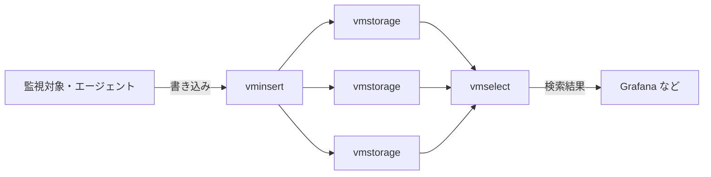

# Vol.35 Platforms × Adopt

> 非公式の解説です（Thoughtworks とは関係がありません）。Claude Code（AI）が作成しました。人が公開を承認していますが、内容の正確さを人が個別に確かめてはいません。節の冒頭の「状態」が「下書き」の節は、作成中です。詳しくは [README](../README.md) を参照してください。

Technology Radar Vol.35（2026年11月）で、Platforms の Adopt に置かれた技術の解説です。

## 目次

- [VictoriaMetrics](#victoriametrics)

---

## VictoriaMetrics

**状態**: 公開承認済み（2026-11-08、内容は人による検証なし）

### 1. 一言でいうと

VictoriaMetrics は、監視のためのメトリクス（CPU 使用率やリクエスト数など、時刻と数値の組が並ぶ時系列データ）を、大量に貯めて検索するためのオープンソースのデータベースです。Prometheus と互換の API を持ち、Prometheus の長期保存先としても、Prometheus の代わりとしても使えます（[公式ドキュメント](https://docs.victoriametrics.com/victoriametrics/single-server-victoriametrics/)）。ライセンスは Apache License 2.0 です（[GitHub](https://github.com/VictoriaMetrics/VictoriaMetrics)）。

### 2. 解決する課題（なぜ生まれたか）

Prometheus は、監視対象からのメトリクスの収集・保存・検索を、1台のサーバーで担う設計です。Prometheus のドキュメントは、手元のストレージはクラスタ化も複製もされず、1台のノードの拡張性と耐久性に限られると説明しています。1台を超える拡張性や耐久性が要る場合のために、外部のストレージとつなぐ仕組み（remote write 等）が用意されています（[Prometheus: Storage](https://prometheus.io/docs/prometheus/latest/storage/)）。

一般に、監視の規模が大きくなると、次のような課題が出てきます。

- **高カーディナリティ**: ラベル（例: ユーザーID、Pod 名）の組み合わせが増え、時系列の数が数百万に達すると、メモリとディスクが足りなくなる
- **高チャーン**: Kubernetes のように Pod が頻繁に入れ替わる環境では、新しい時系列が次々に生まれては消える
- **長期保存のコスト**: 数か月〜数年分のデータを持つと、ディスクの容量と検索の速さが問題になる

VictoriaMetrics は、これらを少ない資源でこなすことを狙っています。開発元は、高カーディナリティの条件で Prometheus・Thanos・Cortex に比べて RAM が最大7分の1、ディスクが最大7分の1（ある比較での値）で済むと主張しています（[公式ドキュメント](https://docs.victoriametrics.com/victoriametrics/single-server-victoriametrics/)）。ただし、これらは**開発元自身のベンチマーク**です。自分たちのデータで確かめる必要があります。

### 3. 仕組みの概要

**2つの形態**

- **単一ノード版**: 1つの実行ファイルで動き、外部への依存がありません。データは1つのディレクトリに置き、設定はコマンドラインの引数で行います（[公式ドキュメント](https://docs.victoriametrics.com/victoriametrics/single-server-victoriametrics/)）
- **クラスター版**: 役割の違う3つの部品に分かれ、それぞれを独立に増やせます（[公式ドキュメント](https://docs.victoriametrics.com/victoriametrics/cluster-victoriametrics/)）
  - `vminsert`: データを受け取り、メトリクス名とラベルから計算したハッシュ（consistent hashing）で、どの `vmstorage` に置くかを振り分ける
  - `vmstorage`: データを保存し、検索の要求に応える。`vmstorage` どうしは互いを知らず、通信もしない（shared-nothing）
  - `vmselect`: 検索を受け付け、すべての `vmstorage` からデータを集めて結果をまとめる

**書き込みと検索**

- 書き込み: Prometheus の remote write、監視対象からの収集（scrape）のほか、InfluxDB・Graphite・OpenTSDB の形式、OpenTelemetry の形式などを受け付けます（[公式ドキュメント](https://docs.victoriametrics.com/victoriametrics/single-server-victoriametrics/)）
- 検索: PromQL をもとにした独自の言語 **MetricsQL** を使います。開発元は PromQL と後方互換だとしていますが、意図的な違いもあります。たとえば、`rate()` や `increase()` で値を外挿しません（[MetricsQL](https://docs.victoriametrics.com/victoriametrics/metricsql/)）。Prometheus と同じ検索 API を持つので、Grafana からは Prometheus のデータソースとしてそのまま使えます

**周辺の部品**: 収集と転送を担う `vmagent`、アラートと記録ルールを評価する `vmalert`、認証と振り分けを担うプロキシの `vmauth`、スナップショットから S3 などへバックアップする `vmbackup` があります。Kubernetes 向けには Operator も用意されています（[vmagent](https://docs.victoriametrics.com/victoriametrics/vmagent/)、[vmalert](https://docs.victoriametrics.com/victoriametrics/vmalert/)、[vmauth](https://docs.victoriametrics.com/victoriametrics/vmauth/)、[vmbackup](https://docs.victoriametrics.com/victoriametrics/vmbackup/)、[Operator](https://docs.victoriametrics.com/operator/)）。

### 4. アーキテクチャ上の位置づけとトレードオフ

**位置づけ**: 監視（オブザーバビリティ）基盤の中で、メトリクスを保存して検索する層にあたります。入れ方は大きく2通りです。

- Prometheus は収集に残し、remote write で VictoriaMetrics に送って長期保存する
- `vmagent` と `vmalert` を使い、Prometheus を含めて全体を置き換える

**代償にするもの**

- **一貫性より可用性**: クラスター版は、データの一貫性より可用性を優先すると明言しています。`vmstorage` が止まると、`vminsert` は新しいデータを健全なノードへ回します。検索は、一部のノードが欠けた状態の結果を返すことがあります（[公式ドキュメント](https://docs.victoriametrics.com/victoriametrics/cluster-victoriametrics/)）。筆者の見立てでは、監視の用途なら多くの場合これで困りませんが、完全な数値が要る用途（課金の集計など）では注意が要ります。完全な結果が要る場合は、部分的な結果を返さずエラーにする設定や、データの複製で対処できます（同じページ）
- **単純さの裏返し**: `vmstorage` どうしが通信しない作りは、構成を単純にします。その代わり、ノードを足しても過去のデータは自動では並べ直されません（[FAQ](https://docs.victoriametrics.com/victoriametrics/faq/)）
- **PromQL との差**: 外挿の有無などで、Prometheus と数値がわずかに変わることがあります。移行の際は、ダッシュボードとアラートの値を見比べる必要があります
- **無償版と有償版の境目**: ダウンサンプリング、データの種類ごとに保持期間を変える機能、バックアップの自動化、全部品の mTLS などは、エンタープライズ版だけの機能です（[Enterprise](https://docs.victoriametrics.com/victoriametrics/enterprise/)）
- **開発元への依存**（筆者の見立て）: 開発は主に開発元のコアチームが担っているとみられ、機能の方向性はその判断に左右されえます。Apache 2.0 で公開されているのはコミュニティ版で、エンタープライズ版の機能はこの範囲に含まれません

### 5. 採用を判断するときの観点

- **規模**: 開発元は、取り込みが毎秒100万点程度に満たないなら、単一ノード版を勧めています（[公式ドキュメント](https://docs.victoriametrics.com/victoriametrics/cluster-victoriametrics/)）。まず単一ノード版で足りるかを見積もる
- **既存の資産**: Prometheus の収集の設定や Grafana のダッシュボードを生かせるか。MetricsQL との差を許容できるか
- **運用の体制**: 自分たちで運用（セルフホスト）する体制があるか。クラウドのマネージドサービス（Prometheus 互換のもの）と比べて、費用と手間はどうか
- **必要な機能が無償版にあるか**: ダウンサンプリングや保持期間の使い分けが要るなら、エンタープライズ版の契約が前提になる
- **可用性の作り方**: 単一ノード版の冗長化は、同じ設定の複数台へ `vmagent` で同時に書き込み、読み出しを `vmauth` で振り分けるか、上位の `vmselect` で複数台をまとめて検索する形になる（[公式ドキュメント](https://docs.victoriametrics.com/victoriametrics/single-server-victoriametrics/)の High availability の節）。クラスター版では、複製の数を指定できる（[クラスター版](https://docs.victoriametrics.com/victoriametrics/cluster-victoriametrics/)）
- **検証**: 性能の数値は開発元の主張なので、実際のデータとクエリで負荷試験をする

### 6. 関連技術・代替技術

- **Prometheus**: VictoriaMetrics が互換を保っている監視システム。小規模なら Prometheus 単体で足りることも多い（[Prometheus](https://prometheus.io/)）
- **Thanos、Cortex、Grafana Mimir**: Prometheus の長期保存と水平拡張のための仕組み（[Thanos](https://thanos.io/)、[Cortex](https://cortexmetrics.io/)、[Grafana Mimir](https://grafana.com/oss/mimir/)）。Thanos と Mimir はオブジェクトストレージにデータを保存します。VictoriaMetrics は、指定したローカルのディレクトリ（`-storageDataPath`）に保存します（[公式ドキュメント](https://docs.victoriametrics.com/victoriametrics/single-server-victoriametrics/)）
- **InfluxDB、TimescaleDB**: 監視に限らない汎用の時系列データベース（一般的な説明）
- **VictoriaLogs**: 同じ開発元のログ用データベース。Vol.35 では Platforms の Trial に置かれている（[VictoriaLogs](https://docs.victoriametrics.com/victorialogs/)）
- **OpenTelemetry**: メトリクスなどを集める標準。VictoriaMetrics は OpenTelemetry の形式で受け取れる

### 7. Radar での扱い

- Vol.35（2026年11月）: **Adopt**（Trial から移動）
- 過去の版: 2022年10月の版で Trial
- Thoughtworks の評価の要旨: 大規模な監視基盤を自分たちで運用する組織にとって、実運用に耐える段階に達したと見ています。理由として、大量で高カーディナリティのメトリクスに強いこと、単一ノード版とクラスター版を規模に応じて選べること、Prometheus や OpenTelemetry と互換があり既存の資産を生かせることを挙げています
- Radar のページ: https://www.thoughtworks.com/en-us/radar/platforms/summary/victoriametrics （版ごとの推移: https://www.thoughtworks.com/en-us/radar/platforms/victoriametrics ）

### 8. 深掘りするときの一次情報

- [VictoriaMetrics 公式ドキュメント（単一ノード版）](https://docs.victoriametrics.com/victoriametrics/single-server-victoriametrics/)
- [クラスター版](https://docs.victoriametrics.com/victoriametrics/cluster-victoriametrics/)
- [MetricsQL](https://docs.victoriametrics.com/victoriametrics/metricsql/)
- [FAQ](https://docs.victoriametrics.com/victoriametrics/faq/)
- [エンタープライズ版の機能](https://docs.victoriametrics.com/victoriametrics/enterprise/)
- [GitHub リポジトリ](https://github.com/VictoriaMetrics/VictoriaMetrics)

### 9. 確認日

- 内容の確認日: 2026-11-08（確認時点の最新のリリースは v1.155.0。GitHub の Releases で Latest 表示、2026-10-23 リリース）
- Radar の評価の確認日: 2026-11-08

---
