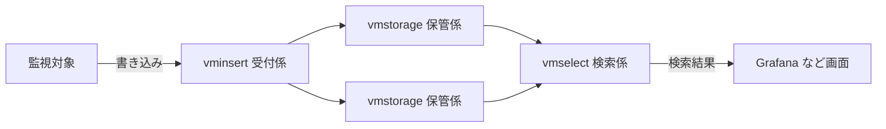

# VictoriaMetrics

> 非公式の解説です（Thoughtworks とは関係がありません）。Claude Code（AI）が作成しました。状態が「公開承認済み」の解説は人が公開を承認していますが、内容の正確さを人が個別に確かめてはいません。「下書き」の解説は承認前の作成中のものです。詳しくは [README](../../README.md) を参照してください。

| 項目 | 内容 |
|---|---|
| 版 | Technology Radar Vol.35（2026年11月） |
| 象限 | Platforms（アプリケーションを載せて動かす基盤・サービス） |
| リング | Adopt（Trial から移動） |
| 状態 | 下書き |

## 1. 一言でいうと

VictoriaMetrics は、サーバーやアプリケーションの「調子」を表す数値（**メトリクス**。CPU 使用率や1秒あたりのリクエスト数など）を、時刻つきで大量に貯めておき、あとから素早く取り出すためのデータベースです。無料で使える**オープンソース**で、ライセンスは Apache License 2.0 です（[GitHub](https://github.com/VictoriaMetrics/VictoriaMetrics)）。監視の定番ツールである **Prometheus** と同じ方法で読み書きできるので、Prometheus の保存先としても、Prometheus の代わりとしても使えます（[公式ドキュメント](https://docs.victoriametrics.com/victoriametrics/single-server-victoriametrics/)）。

たとえるなら、体温や血圧を毎分記録し続けるカルテの保管庫です。ため込むだけでなく、「熱が上がったのはいつか」をすぐ探せることが大事です。

## 2. 解決する課題（なぜ生まれたか）

システムを運用するときは、サーバーやアプリケーションの数値を数秒〜数十秒ごとに記録し続け、異常が起きていないかを見張ります（**監視**）。このように「時刻と数値の組」が並んだデータを**時系列データ**と呼びます。

Prometheus は、監視対象から数値を集め（**スクレイプ**）、保存し、検索する仕組みを、1台のサーバーで担います。Prometheus 自身のドキュメントも、手元の保存領域は複数台に分けたり（クラスター化）、複製したりできず、1台のサーバーの能力と耐久性に限られると説明しています。1台を超える規模や耐久性が要る場合のために、外部の保存先へデータを送る仕組み（**remote write**）が用意されています（[Prometheus: Storage](https://prometheus.io/docs/prometheus/latest/storage/)）。

一般に、監視の規模が大きくなると、次のような課題が出てきます。

- **記録する系列の数が爆発する**（**高カーディナリティ**）: 数値には「どのサーバーか」「どの画面か」といった**ラベル**が付きます。ラベルの組み合わせが増えると、別々に記録する系列が数百万にもなり、メモリとディスクが足りなくなります
- **系列が次々に入れ替わる**（**高チャーン**）: **Kubernetes** のように、アプリケーションの入れ物（**Pod**）が頻繁に作り直される環境では、新しい系列が生まれては消えていきます
- **長く残すほど高くつく**: 数か月〜数年分を持つと、ディスクの容量と検索の速さが問題になります

VictoriaMetrics は、これらを少ないメモリとディスクでこなすことを狙っています。開発元は、系列の多い条件で Prometheus などに比べてメモリが最大7分の1、ディスクが最大7分の1（ある比較での値）で済むと主張しています（[公式ドキュメント](https://docs.victoriametrics.com/victoriametrics/single-server-victoriametrics/)）。ただし、これは**開発元自身による比較**です。

## 3. 仕組みの概要

**2つの形態**があります。

- **単一ノード版**: 1つのプログラムだけで動き、ほかのソフトウェアを必要としません。データは1つのフォルダに置きます（[公式ドキュメント](https://docs.victoriametrics.com/victoriametrics/single-server-victoriametrics/)）。まずはこちらから始めるのが基本です
- **クラスター版**: 役割の違う3種類の部品に分かれ、それぞれの台数を別々に増やせます（[公式ドキュメント](https://docs.victoriametrics.com/victoriametrics/cluster-victoriametrics/)）
  - `vminsert`（受付係）: データを受け取り、どの保管係に預けるかを決める。メトリクスの名前とラベルから計算した値で、毎回同じ保管係に振り分ける
  - `vmstorage`（保管係）: データを保存する。保管係どうしは互いを知らず、連絡も取り合わない
  - `vmselect`（検索係）: 検索を受け付け、すべての保管係からデータを集めて答えをまとめる

**読み書きの方法**: 書き込みは、Prometheus の remote write のほか、ほかの監視ツール（InfluxDB・Graphite など）の形式や、**OpenTelemetry** の形式でも受け付けます。検索には **MetricsQL** という言語を使います。Prometheus の検索言語 **PromQL** をもとにしており、ほぼ同じ書き方で使えますが、一部の計算は意図的に違う結果を返します（[MetricsQL](https://docs.victoriametrics.com/victoriametrics/metricsql/)）。グラフ表示の定番ツール **Grafana** からは、Prometheus と同じように接続できます。

**周辺の部品**として、数値を集めて送る `vmagent`、異常を見つけて知らせる `vmalert`、入口で認証と振り分けをする `vmauth`、バックアップを取る `vmbackup` があります（[vmagent](https://docs.victoriametrics.com/victoriametrics/vmagent/)、[vmalert](https://docs.victoriametrics.com/victoriametrics/vmalert/)）。

## 4. アーキテクチャ上の位置づけとトレードオフ

**位置づけ**: 監視の仕組みの中で、「数値を貯めて、探す」部分にあたります。入れ方は大きく2通りです。

- 集める役は Prometheus のまま残し、remote write で VictoriaMetrics に送って長く保存する
- 集める役も `vmagent` に任せ、Prometheus ごと置き換える

**代わりに失うもの**

- **止まらないことを優先する**: クラスター版は、データの完全さより、止まらずに動き続けることを優先すると明言しています。保管係の一部が止まると、新しいデータはほかの保管係に回され、検索結果は一部が欠けた状態で返ることがあります（[公式ドキュメント](https://docs.victoriametrics.com/victoriametrics/cluster-victoriametrics/)）。筆者の見立てでは、監視の用途ならたいてい困りませんが、完全な数値が要る用途（課金の集計など）では注意が要ります。欠けたときにエラーにする設定や、データの複製で対処できます（同じページ）
- **単純さの裏返し**: 保管係どうしが連絡を取らない作りは、全体を単純にします。その代わり、保管係を増やしても、過去のデータは自動では移りません（[FAQ](https://docs.victoriametrics.com/victoriametrics/faq/)）
- **PromQL との小さな違い**: Prometheus から移ると、グラフの値がわずかに変わることがあります。移行の際は見比べる必要があります
- **一部の機能は有料版だけ**: 古いデータを間引いて容量を節約する機能（**ダウンサンプリング**）、データごとに保存期間を変える機能、バックアップの自動化などは、有料のエンタープライズ版だけの機能です（[Enterprise](https://docs.victoriametrics.com/victoriametrics/enterprise/)）
- **開発元への依存**（筆者の見立て）: 開発は主に開発元のコアチームが担っているとみられ、機能の方向性はその判断に左右されえます。Apache 2.0 で公開されているのは無料のコミュニティ版で、エンタープライズ版の機能はこの範囲に含まれません

## 5. 採用を判断するときの観点

- **規模**: 開発元は、書き込みが毎秒100万件程度に満たないなら単一ノード版を勧めています（[公式ドキュメント](https://docs.victoriametrics.com/victoriametrics/cluster-victoriametrics/)）
- **今の道具**: すでに Prometheus や Grafana を使っているなら、設定や画面をほぼそのまま生かせます
- **運用の担い手**: 自分たちでサーバーを用意して運用する（**セルフホスト**）体制があるか。クラウド事業者が運用を代行する**マネージドサービス**と比べて、費用と手間はどうか
- **必要な機能**: ダウンサンプリングなどが要るなら、有料版の契約が前提になります
- **止まらない作り（可用性）をどう確保するか**: 単一ノード版で**冗長化**（予備を用意して1台が止まっても続けられるようにすること）するには、同じ設定の複数台へ `vmagent` で同時に書き込み、読み出しを `vmauth` で振り分けるか、上位の `vmselect` で複数台をまとめて検索します（[公式ドキュメント](https://docs.victoriametrics.com/victoriametrics/single-server-victoriametrics/)の High availability の節）。クラスター版では、データの複製の数を指定できます（[クラスター版](https://docs.victoriametrics.com/victoriametrics/cluster-victoriametrics/)）- **自分たちのデータで試す**: 性能の数値は開発元の主張なので、実際のデータで負荷をかけて確かめます

## 6. 関連技術・代替技術

- **Prometheus**: 規模が小さければ Prometheus だけで足りることも多い（[Prometheus](https://prometheus.io/)）
- **Thanos、Cortex、Grafana Mimir**: Prometheus のデータを長く、大規模に保存する仕組み（[Thanos](https://thanos.io/)、[Cortex](https://cortexmetrics.io/)、[Grafana Mimir](https://grafana.com/oss/mimir/)）。Thanos と Mimir は**オブジェクトストレージ**に保存し、VictoriaMetrics はサーバーのディスクに保存する点が違う
- **InfluxDB、TimescaleDB**: 監視に限らず使える時系列データベース（一般的な説明）
- **VictoriaLogs**: 同じ開発元のログ用データベース。Vol.35 では Platforms の Trial（[VictoriaLogs](https://docs.victoriametrics.com/victorialogs/)）

## 7. Radar での扱い

- Vol.35（2026年11月）: **Adopt**（Trial から移動）
- 過去の版: 2022年10月の版で Trial
- Thoughtworks の評価の要旨: 大規模な監視の仕組みを自分たちで運用する組織にとって、実運用に耐える段階に達したと見ています。理由として、大量で系列の多いメトリクスに強いこと、規模に応じて単一ノード版とクラスター版を選べること、Prometheus や OpenTelemetry と互換があり今の道具を生かせることを挙げています
- Radar のページ: https://www.thoughtworks.com/en-us/radar/platforms/summary/victoriametrics （版ごとの推移: https://www.thoughtworks.com/en-us/radar/platforms/victoriametrics ）

## 8. 深掘りするときの一次情報

- [公式ドキュメント（単一ノード版）](https://docs.victoriametrics.com/victoriametrics/single-server-victoriametrics/)
- [クラスター版](https://docs.victoriametrics.com/victoriametrics/cluster-victoriametrics/)
- [MetricsQL](https://docs.victoriametrics.com/victoriametrics/metricsql/)
- [エンタープライズ版の機能](https://docs.victoriametrics.com/victoriametrics/enterprise/)
- [GitHub リポジトリ](https://github.com/VictoriaMetrics/VictoriaMetrics)

## 9. 確認日

- 内容の確認日: 2026-11-08（確認時点の最新のリリースは v1.155.0）
- Radar の評価の確認日: 2026-11-08（リングの推移は、Radar の版ごとの推移のページで確認）

## 用語集

| 用語 | 説明 |
|---|---|
| メトリクス | システムの状態を表す数値。CPU 使用率、メモリ使用量、1秒あたりのリクエスト数、エラーの件数など |
| 時系列データ | 「いつ、いくつだったか」という時刻と数値の組が、時間の順に並んだデータ |
| 監視 | システムの数値を記録し続け、異常があれば知らせる仕組みや作業。最近は、内部の状態を外から把握できるようにする「オブザーバビリティ（可観測性）」という言葉もよく使われる |
| オープンソース | ソースコードが公開され、決められた条件（ライセンス）のもとで誰でも使える・改変できるソフトウェア。Apache License 2.0 は、商用でも使いやすい代表的なライセンス |
| Prometheus | 監視の分野で広く使われているオープンソースのツール。監視対象から数値を定期的に集めて保存し、検索やアラートに使う |
| ラベル・カーディナリティ | ラベルは数値に付ける目印（「サーバー名」など）で、値の組み合わせごとに別の系列として記録される。その組み合わせの数をカーディナリティと呼び、多いほど保存の負担が大きい |
| Kubernetes | 多数のコンテナ（アプリケーションを動かすための軽い入れ物）を、まとめて配置・管理する仕組み |
| Pod | Kubernetes でアプリケーションを動かす最小の単位。必要に応じて作り直されるので、名前が頻繁に変わる |
| 冗長化・可用性 | 冗長化は、予備の機器やデータを用意しておき、一部が壊れても止まらないようにすること。可用性は、システムが止まらずに使える度合い |
| OpenTelemetry | メトリクスやログなどの監視データを集めて送る方法を共通化した、業界の標準の取り組み |
| PromQL / MetricsQL | PromQL は Prometheus の検索言語。MetricsQL は VictoriaMetrics の検索言語で、PromQL をもとに機能を足したもの |
| Grafana | 監視データをグラフや表にして画面に表示する、広く使われているツール |
| ダウンサンプリング | 古いデータを、たとえば「1分ごと」から「1時間ごと」のように間引いて、容量を節約すること |
| オブジェクトストレージ | Amazon S3 などの、ファイルをネットワーク越しに大量・安価に保存するクラウドのサービス |
| セルフホスト / マネージドサービス | セルフホストは自分たちでサーバーを用意して運用すること。マネージドサービスは、クラウド事業者が運用を代行してくれるサービス |
