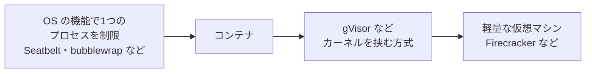

# Agent sandboxing（エージェントのサンドボックス化）

> 非公式の解説です（Thoughtworks とは関係がありません）。Claude Code（AI）が作成しました。状態が「公開承認済み」の解説は人が公開を承認していますが、内容の正確さを人が個別に確かめてはいません。「下書き」の解説は承認前の作成中のものです。詳しくは [README](../../README.md) を参照してください。

| 項目 | 内容 |
|---|---|
| 版 | Technology Radar Vol.35（2026年11月） |
| 象限 | Techniques（開発や運用の進め方・手法） |
| リング | Adopt（新規か移動かは Radar のページに明記なし） |
| 状態 | 下書き |

## 1. 一言でいうと

Agent sandboxing は、AI **エージェント**（指示を受けて、自分でツールを使いながら作業を進める AI）を、外から切り離された囲いの中（**サンドボックス**）で、必要最小限の権限だけを与えて動かす手法です。エージェントが思わぬ動きをしたり、だまされて悪い操作をしたりしても、被害が囲いの外に広がらないようにします。

たとえるなら、新人に仕事を任せるときに、会社の全部の鍵を渡すのではなく、作業する部屋の鍵だけを渡し、外部への電話は決まった相手にしかかけられないようにしておくことです。

## 2. 解決する課題（なぜ生まれたか）

最近の AI エージェントは、ファイルを書き換えたり、コマンドを実行したり、メールを送ったり、社内のシステムを操作したりできます。便利な反面、次のような危険があります。

- **プロンプトインジェクション**: エージェントが読んだメールや Web ページの中に、悪意ある指示が紛れ込んでいて、エージェントがそれに従ってしまう
- **思い違い**: AI が指示を取り違えたり、事実でないことをもっともらしく生成したり（**ハルシネーション**）して、意図しない操作をする

OWASP（Web のセキュリティの非営利団体）は、LLM（大規模言語モデル）を使うアプリケーションの主なリスクの1つとして「**過剰な権限（Excessive Agency）**」を挙げています。AI の出力が予想外だったり、操作されたりしたときに、損害を生む操作ができてしまうことです。原因として、機能が多すぎる、権限が強すぎる、人の確認なしに動ける範囲が広すぎる、の3つを挙げています（[OWASP LLM06:2025](https://genai.owasp.org/llmrisk/llm062025-excessive-agency/)）。

AI が「だまされない」ことは保証できません。そこで、「だまされても大きな被害が出ない環境で動かす」という考え方が必要になります。これがサンドボックス化です。

## 3. 仕組みの概要

**基本の考え方は2つ**です。

- **サンドボックス**: 実行できる範囲を制限し、許可されたもの以外の資源（ファイル・ネットワークなど）に触れられないようにした実行環境（[NIST の用語集](https://csrc.nist.gov/glossary/term/sandbox)）
- **最小権限の原則**: 利用者やプログラムに与える権限を、仕事に必要な最小限に絞るというセキュリティの原則（[NIST の用語集](https://csrc.nist.gov/glossary/term/least_privilege)）

**制限する対象**は、主に次の3つです。

- **ファイル**: 書き込めるのは作業用のフォルダだけにする。パスワードや鍵の入ったファイルは読ませない
- **ネットワーク**: 接続してよい相手を許可リストで決め、それ以外には出られないようにする。情報の持ち出しを防ぐ
- **外部のシステム**: データベースは読み取り専用にする、メールは下書きまでにする、など操作の種類を絞る

**囲いの強さ**には段階があります。

一般的な目安としての並べ方です（筆者の整理）。右に行くほど囲いの中と外の結びつきが弱く、隔離が強くなる傾向があり、そのぶん準備や動作の負担が増えることがあります。ただし、どれが強いかは構成によって変わり、特に gVisor とマイクロ VM の比較は意見が分かれます。

- **コンテナ**（Docker など）: Linux の機能（**名前空間**と **cgroups**）で、プロセスどうしを見えなくし、使える資源を制限します。既定の設定では隔離が不完全になりうるので、不要な権限を外すことが勧められています（[Docker のセキュリティ](https://docs.docker.com/engine/security/)）
- **gVisor**: アプリケーションが出す OS への要求（**システムコール**）を途中で受け取り、自前で処理することで、アプリケーションの要求がホストの OS の中核（カーネル）に直接届かないようにし、ホストに触れる範囲を狭める仕組みです（[gVisor](https://gvisor.dev/)）
- **Firecracker**: 起動が速く負担の小さい「**マイクロ VM**」（軽量な仮想マシン）を作る技術です。AWS Lambda などのサービスのために開発されました（[Firecracker](https://firecracker-microvm.github.io/)）

**製品の例**: コーディング用のエージェントの Claude Code は、シェルのコマンドを OS の機能で囲う機能を持っています（macOS では Seatbelt、Linux では bubblewrap を使う）。この機能は既定ではオフです。有効にすると、書き込めるのは作業フォルダ・一時フォルダ・追加したフォルダに限られ、外部への接続は許可リストに載った相手だけに中継されます。ただし、読み取りは既定では広く許されているため、鍵などのファイルを読ませないには別の設定が要ります（[Claude Code のサンドボックス](https://code.claude.com/docs/en/sandboxing)）。

## 4. アーキテクチャ上の位置づけとトレードオフ

**位置づけ**: エージェントを組み込んだシステムの「実行環境」と「権限の設計」にあたります。エージェントに「やってはいけないこと」を言い聞かせる（プロンプトで指示する）のではなく、**仕組みの側で止める**のが要点です。OWASP も、操作してよいかの判断を AI に任せず、操作される側のシステムで権限を確かめるよう勧めています（[OWASP LLM06:2025](https://genai.owasp.org/llmrisk/llm062025-excessive-agency/)）。

**代わりに失うもの**

- **使い勝手**: 囲いを厳しくするほど、エージェントができることが減ります。新しい接続先が要るたびに許可が必要になり、作業が止まりやすくなります（[Claude Code のサンドボックス](https://code.claude.com/docs/en/sandboxing)）
- **完全ではない**: サンドボックスはリスクを減らしますが、完全な隔離の境界ではありません。たとえば、広く使われるサイト全体への接続を許すと、そこが情報の持ち出し口になりえます（同じページ）。gVisor のドキュメントも、サンドボックスは安全な設計の代わりにはならないと述べています（[gVisor のセキュリティモデル](https://gvisor.dev/docs/architecture_guide/security/)）
- **抜け道の管理**: 特定のコマンドを囲いの外で動かす設定など、例外を作るとそこが弱点になります。外したコマンドは利用者と同じ権限で動きます（[Claude Code のサンドボックス](https://code.claude.com/docs/en/sandboxing)）
- **準備と負担**: 強い隔離（仮想マシンなど）ほど、環境の用意や動作の負担が増える傾向があります（筆者の見立て。どの程度かは方式と使い方によります）

## 5. 採用を判断するときの観点

- **エージェントが触れるものの洗い出し**: どのファイル・システム・外部サービスに触れるか。そのうち、壊れたり漏れたりすると困るものはどれか。Thoughtworks は、**脅威モデリング**（どんな攻撃や事故がありうるかを整理する作業）にもとづいてリスクに応じた囲い方を決めるよう勧めています（[Radar のページ](https://www.thoughtworks.com/en-us/radar/techniques/agent-sandboxing)）
- **囲いの強さの選択**: 自分の端末で使う開発用のエージェントなら OS の機能やコンテナで足りることが多く、外部の人が入力できる業務用のエージェントなら仮想マシン級の隔離も検討する、というようにリスクに合わせて選ぶ（筆者の見立て）
- **ネットワークの許可リスト**: 接続先を必要最小限にする。持ち出しの経路になる広い許可は避ける
- **人の承認を挟む操作**: 送金・削除・外部への送信など影響の大きい操作は、人が承認してから実行する（[OWASP LLM06:2025](https://genai.owasp.org/llmrisk/llm062025-excessive-agency/)）
- **記録と監視**: エージェントの操作の記録を残し、異常に気づけるようにする。被害を小さくする助けになります（同じページ）

## 6. 関連技術・代替技術

- **Threat modeling（脅威モデリング）**: 囲い方を決める前提になる手法。Vol.35 では Techniques の Adopt に置かれている
- **Sandboxed execution for coding agents**: コーディング用のエージェントに限ったサンドボックス化。前の版（2026年4月）で Techniques の Trial に置かれていた（[Radar のページ](https://www.thoughtworks.com/en-us/radar/techniques/sandboxed-execution-for-coding-agents)）
- **コンテナ、gVisor、Firecracker**: 囲いを作るための技術（第3節）
- **権限の設定（パーミッション）**: エージェントの道具の側で、操作ごとに許可・確認・拒否を決める仕組み。Claude Code のドキュメントは、サンドボックスと権限の設定を、互いを補う層として説明している（[Claude Code の権限](https://code.claude.com/docs/en/permissions)）

## 7. Radar での扱い

- Vol.35（2026年11月）: **Adopt**。Radar のページは、新規か移動かを明記していません
- 過去の版: 前の版（2026年4月）では、コーディング用のエージェントに限った「Sandboxed execution for coding agents」が Trial に置かれていました。今回は対象をすべてのエージェントに広げた形です
- Thoughtworks の評価の要旨: エージェントがコードだけでなく業務のシステムでも動くようになったため、コーディング用に限らず、すべてのエージェントで当たり前に行うべきことだと見ています。予想外の動きや悪用の被害を小さくできることを挙げ、最近のセキュリティの事故を受けて、最小権限などの確立した原則をエージェントにも当てはめるべきだとしています。万能の方法は無く、脅威モデリングにもとづいてリスクに応じて決めるべきだとしています
- Radar のページ: https://www.thoughtworks.com/en-us/radar/techniques/agent-sandboxing

## 8. 深掘りするときの一次情報

- [OWASP Top 10 for LLM Applications: LLM06:2025 Excessive Agency](https://genai.owasp.org/llmrisk/llm062025-excessive-agency/)
- [NIST 用語集: sandbox](https://csrc.nist.gov/glossary/term/sandbox) ／ [least privilege](https://csrc.nist.gov/glossary/term/least_privilege)
- [Docker: Security](https://docs.docker.com/engine/security/)
- [gVisor](https://gvisor.dev/) ／ [セキュリティモデル](https://gvisor.dev/docs/architecture_guide/security/)
- [Firecracker](https://firecracker-microvm.github.io/)
- [Claude Code: Sandboxing](https://code.claude.com/docs/en/sandboxing) ／ [Permissions](https://code.claude.com/docs/en/permissions)

## 9. 確認日

- 内容の確認日: 2026-11-08
- Radar の評価の確認日: 2026-11-08

## 用語集

| 用語 | 説明 |
|---|---|
| AI エージェント | 目的を与えられると、ファイルの操作・コマンドの実行・Web の検索などの道具を自分で選んで使いながら、作業を進める AI |
| サンドボックス | 「砂場」の意味。中で何をしても外に影響が出ないように、触れられる範囲を制限した実行環境 |
| 最小権限の原則 | 人やプログラムに与える権限を、仕事に必要な最小限にとどめるというセキュリティの基本の考え方 |
| LLM | 大規模言語モデル。大量の文章で学習し、文章を理解・生成する AI。ChatGPT や Claude などの中核 |
| プロンプトインジェクション | AI が読み込む文章に命令を紛れ込ませて、AI に本来の指示と違うことをさせる攻撃 |
| ハルシネーション | AI が事実でない内容を、もっともらしく生成してしまうこと |
| OWASP | Web アプリケーションのセキュリティの向上に取り組む非営利の団体。主なリスクの一覧（Top 10）で知られる |
| NIST | 米国の国立標準技術研究所。セキュリティの用語や指針を数多く公開している |
| コンテナ | アプリケーションと、その動作に必要なものをひとまとめにして、ほかから切り離して動かす仕組み。Docker が代表例。ホストの OS の中核（カーネル）は共有する（一般的な説明） |
| 名前空間・cgroups | Linux の機能。名前空間はプロセスから見えるもの（ほかのプロセスやファイルなど）を区切り、cgroups は使える CPU やメモリの量を制限する |
| システムコール | アプリケーションが OS に「ファイルを開いて」「通信して」などを頼むときの呼び出し |
| 仮想マシン（VM） | 1台の物理的なコンピュータの上に、ソフトウェアで別のコンピュータを作り出す仕組み。中で動く OS ごと切り離せるので、隔離が強い |
| 脅威モデリング | システムに対してどんな攻撃や事故がありうるか、どこが弱いかを、設計の段階で整理する作業 |
| 許可リスト | 「これだけは許す」という一覧。載っていないものはすべて拒否する方式 |
