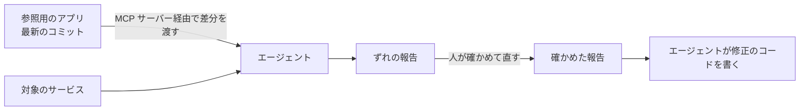

# Anchoring coding agents to a reference application（コーディングエージェントを参照用のアプリにつなぎとめる）

> 非公式の解説です（Thoughtworks とは関係がありません）。Claude Code（AI）が作成しました。状態が「公開承認済み」の解説は人が公開を承認していますが、内容の正確さを人が個別に確かめてはいません。「下書き」の解説は承認前の作成中のものです。詳しくは [README](../../README.md) を参照してください。

| 項目 | 内容 |
|---|---|
| 版 | Technology Radar Vol.35（2026年11月） |
| 象限 | Techniques（開発や運用の進め方・手法） |
| リング | Trial（Assess から移動） |
| 状態 | 下書き |

## 1. 一言でいうと

Anchoring coding agents to a reference application は、**コーディングエージェント**（コードを読み書きし、コマンドを実行しながら開発の作業を進める AI）に、組織の「正しい書き方」の見本として、**実際にビルドして動かせる参照用のアプリ**（reference application）を見せる手法です。エージェントは、その見本と手元のコードを比べ、ずれている箇所を見つけて直します。

たとえるなら、文章の書き方を口頭のルールで伝えるのではなく、「この見本の文書と同じ形にそろえて」と、いつも最新に保たれた見本を手元に置いておくようなものです。見本そのものが動くので、見本が間違っていればすぐに分かります（筆者の見立て）。

## 2. 解決する課題（なぜ生まれたか）

多くの組織は、新しいサービスを作るときの出発点として**サービスのひな形**（テンプレート）を用意します。ログの出し方、エラーの扱い、層の分け方など、推奨の書き方を最初から入れておくためです。

ところが、ひな形から作ったサービスは、その瞬間からひな形と別の道を歩みます。Birgitta Böckeler（Thoughtworks）は、ひな形をあとで更新しても、その変更をすでに作ったサービスに反映させるのは面倒だと指摘しています。また、時間をかけてコードを書き足していくうちに、推奨の書き方からずれていく（**ドリフト**する）ことも挙げています（[Böckeler: Anchoring AI to a reference application](https://martinfowler.com/articles/exploring-gen-ai/anchoring-to-reference.html)。以下、この記事を「Böckeler の記事」と呼ぶ）。

エージェントにコードを書かせる場合も、手本の示し方が問題になります。手本のコードを指示のファイル（Markdown）に貼り付けておく方法もありますが、Böckeler は、それではそのコードが本当にコンパイルできるのか分からないと述べ、動かせる参照用のアプリに置くほうがよいとしています（Böckeler の記事）。

## 3. 仕組みの概要

Böckeler の記事の実験を例に説明します（この節の出典は Böckeler の記事）。

**参照用のアプリ**

ひな形と同じように、ビルドして実行できるアプリです。記事の例は Spring Boot（Java の Web アプリの枠組み）のアプリで、データの読み書き（repository）、業務の処理（service）、外からの要求の受け口（controller）という層ごとの書き方の見本が入っています。

**エージェントからの見せ方: MCP サーバー**

**MCP**（Model Context Protocol）は、AI のアプリと外部のツールやデータをつなぐ共通の約束事です（[Model Context Protocol](https://modelcontextprotocol.io/)）。Böckeler は、参照用のアプリの見本のコードをエージェントに渡す MCP サーバーを自作しました。ずれを調べる実験では、このサーバーを広げて、参照用のアプリの **Git のコミット**（変更の単位）と、その**差分**も取り出せるようにしました。

**ずれの見つけ方と直し方（報告と修正の2段階。間に人の確認を挟む）**

1. **ずれの報告**: エージェントは参照用のアプリの最新のコミットを取り出し、その差分（何が変わったか）を手がかりに、対象のサービスのコードを調べて、ずれの報告を作る
2. **人が確かめる**: 人がこの報告を読み、関係のない指摘を消すなどして直す
3. **直す**: 確かめた報告をもとに、エージェントにずれを埋めるコードを書かせる

記事の実験では、参照用のアプリの controller にログの出力（Slf4j の `@Slf4j` と `log.debug`）を足し、対象のアプリでそれが足りないことをエージェントが見つけられるかを試しました。

差分に絞ったのが要点です。単に「controller どうしを比べて」と頼むと、関係のない比較が大量に出ましたが、コミットを手がかりにすると、確かめる範囲をエージェントに絞らせることができた、と記事は報告しています。

今回の版の Radar のページは、この考え方をもう一歩広げた形にも触れています（第7節）。

## 4. アーキテクチャ上の位置づけとトレードオフ

**位置づけ**: 組織の推奨の作り方（**ゴールデンパス**）を、ひな形という「最初に一度だけ使う型」から、「いつでも参照できる生きた見本」に変える手法です。プラットフォームのチームが見本を保守し、各サービスのチームはエージェントを通じてそれに追いつく、という分担になります（筆者の見立て）。

**得られるもの**

- **見本が正しいことを確かめられる**: 見本は動くアプリなので、コンパイルできるかを確かめられ、複数の見本どうしの一貫性も保ちやすい（Böckeler の記事）。テストで振る舞いまで確かめることもできる（筆者の見立て）
- **作ったあとのサービスにも変更を届けられる**: ひな形を更新するだけでは届かなかった変更を、ずれの報告と修正の形で既存のサービスに広げられる（Böckeler の記事）
- **範囲を絞った確認**: コミットの差分を手がかりにすることで、無関係な指摘を減らせる（Böckeler の記事）

**代わりに失うもの・注意点**

- **決まった手順で直せるものは、決まった手順で**: Böckeler は、ログを1行足すような単純な変更は、OpenRewrite（コードを規則に沿って自動で書き換える道具）のような、毎回同じ結果になる方法を先に考えるよう勧めています。AI が役立つのは、形がばらばらなログを構造化された形にそろえるなど、規則だけでは書きにくい変更だとしています（Böckeler の記事）
- **結果が毎回同じとは限らない**: エージェントの報告は、同じ入力でも変わりうる。だから人が報告を確かめる段階を挟む（筆者の見立て。記事も報告を人が直す流れにしている）
- **見本を保守する手間**: 参照用のアプリ自体を、最新の推奨に合わせて直し続ける持ち主が要る（筆者の見立て）
- **実験の範囲**: 記事の実験は、Böckeler 自身が比較的単純な例と述べています（Böckeler の記事）。記事には、効果を数字で示した結果は載っていません

## 5. 採用を判断するときの観点

- **規模**: 同じ書き方にそろえたいサービスが多いほど効く。サービスが数個なら、人が直接そろえるほうが早いこともある（筆者の見立て）
- **見本の持ち主**: 参照用のアプリを誰が保守し、どの単位でコミットするかを決める。コミットを小さく、意味のある単位にしておくと、差分を手がかりにしやすい（筆者の見立て）
- **自動の書き換えとの使い分け**: OpenRewrite のような道具で書ける変更はそちらに任せ、残りをエージェントに任せる（Böckeler の記事）
- **人の確認の段階**: 報告→確認→修正の流れを、コードレビューの仕組みに組み込む（筆者の見立て）
- **依存先**: MCP サーバーは自作になる場合がある。記事の例も自作のサーバーです（Böckeler の記事）

## 6. 関連技術・代替技術

- **サービスのひな形（Tailored service templates）**: 出発点としての型。この手法はそれを補う。Radar のこの項目のページから、Tailored service templates の項目へリンクが張られています
- **Agent-maintained knowledge bases**: エージェントが保守する知識ベース（[解説](agent-maintained-knowledge-bases.md)）。Radar のこの項目のページから、この項目と OpenWiki の項目へリンクが張られています
- **MCP**: 見本をエージェントに渡す経路（第3節）
- **OpenRewrite のようなコードの自動書き換え**: 決まった規則で直せる変更の代替（第4節）
- **few-shot プロンプト**: 指示の中にいくつかの例を見せて、それにならわせる方法。Böckeler は、この手法の土台にある考え方として挙げています（Böckeler の記事）

## 7. Radar での扱い

- Vol.35（2026年11月）: **Trial**（Assess から移動）
- 過去の版: 2025年11月の版で Assess（Radar のページの推移による）
- Thoughtworks の評価の要旨: ひな形が古くなる問題への対処として、規則を固く埋め込む代わりに、エージェントが実行のたびに最新の情報源（OpenWiki や、エージェントが保守する知識ベースなど）を参照し、骨組みと変わっていく規則を分ける形に広がったと見ています。AI による雛形づくりにもこの形を使い、うまくいったチームがあることを、Trial に上げた理由に挙げています
- Radar のページ: https://www.thoughtworks.com/en-us/radar/techniques/anchoring-coding-agents-to-a-reference-application

## 8. 深掘りするときの一次情報

- [Böckeler: Anchoring AI to a reference application（martinfowler.com）](https://martinfowler.com/articles/exploring-gen-ai/anchoring-to-reference.html)
- [Model Context Protocol](https://modelcontextprotocol.io/)

## 9. 確認日

- 内容の確認日: 2026-11-12
- Radar の評価の確認日: 2026-11-12

## 用語集

| 用語 | 説明 |
|---|---|
| コーディングエージェント | コードの読み書きやコマンドの実行を自分で行いながら、開発の作業を何段階も進める AI の仕組み |
| 参照用のアプリ（reference application） | 組織の推奨の書き方を詰め込んだ、実際にビルドして動かせる見本のアプリ |
| サービスのひな形（テンプレート） | 新しいサービスを作るときに複製する出発点のコード。推奨の構成や設定が最初から入っている |
| ゴールデンパス | 組織が推奨する、迷わず進める標準の作り方や道具の組み合わせ |
| ドリフト | 本来そろっているべきもの（ここでは推奨の書き方と実際のコード）が、時間とともにずれていくこと |
| MCP | AI のアプリと外部のツールやデータをつなぐための共通の約束事（プロトコル） |
| コミット | Git で記録する変更の単位。いつ、何を、どう変えたかが残る |
| 差分（diff） | 2つの版のあいだで、どの行が消え、どの行が足されたかを示したもの |
| Spring Boot | Java で Web アプリやサービスを作るための、広く使われている枠組み |
| OpenRewrite | 決まった規則（レシピ）に沿って、ソースコードを自動で一括して書き換える道具 |
| few-shot プロンプト | AI への指示の中にいくつかの例を見せ、それにならった出力をさせる方法。in-context learning（文脈内学習）とも呼ばれる |
