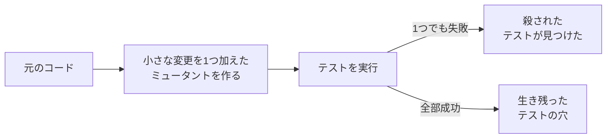

# Mutation testing（ミューテーションテスト）

> 非公式の解説です（Thoughtworks とは関係がありません）。Claude Code（AI）が作成しました。状態が「公開承認済み」の解説は人が公開を承認していますが、内容の正確さを人が個別に確かめてはいません。「下書き」の解説は承認前の作成中のものです。詳しくは [README](../../README.md) を参照してください。

| 項目 | 内容 |
|---|---|
| 版 | Technology Radar Vol.35（2026年11月） |
| 象限 | Techniques（開発や運用の進め方・手法） |
| リング | Adopt（Radar のページの推移では、前の版〈2026年4月〉は Trial。新規か移動かの表示はなし） |
| 状態 | 下書き |
| 図解ページ | [図と動きで見る図解ページ](mutation-testing-intro.html)（この解説の内容を図と動きで見せるページ。サイトで表示。GitHub のリポジトリではソースが表示されます） |

## 1. 一言でいうと

**名前の手がかり**: Mutation〈突然変異〉＋ testing〈試すこと〉

Mutation testing（ミューテーションテスト）は、プログラムにわざと小さな「バグ」を自動で埋め込み、テストがそれを見つけられるか（テストが失敗するか）を確かめることで、**テストそのものの質**を測る手法です。

たとえるなら、警備員の実力を確かめるために、わざと偽の不審者を紛れ込ませてみる「抜き打ちの訓練」です。見つけられなかった偽の不審者は、警備の穴を教えてくれます。

## 2. 解決する課題（なぜ生まれたか）

テストの良し悪しを測る指標として、よく使われるのが**コードカバレッジ**です。テストを動かしたときに、プログラムの何割の行が実行されたかを表します。

しかし、カバレッジには大きな弱点があります。「その行が実行された」ことは分かっても、「その行の結果が正しいかをテストが確かめた」ことまでは分からないのです。極端な例では、結果を何も確かめない（**アサーション**が無い）テストでも、カバレッジは100%になりえます。PIT（Java 向けのツール）のドキュメントも、従来のカバレッジは実行されたコードを測るだけで、そこにある誤りをテストが見つけられるかは確かめない、と説明しています（[PIT](https://pitest.org/)）。

この弱点は、AI がコードとテストを大量に書くようになって、さらに目立つようになりました。Thoughtworks は、カバレッジの数字は浅いテストで簡単に水増しできること、AI が生成したテストには、ロジックの変化を見逃したまま通ってしまうものが混ざりうることを指摘しています（[Radar のページ](https://www.thoughtworks.com/en-us/radar/techniques/mutation-testing)）。

ミューテーションテストは、「テストが本当に誤りを見つけられるか」を直接確かめることで、この問題に答えます。

## 3. 仕組みの概要

### 課題ごとの答え

| 課題 | ミューテーションテストの答え |
|---|---|
| カバレッジは「実行した」ことしか分からない | テストが誤りを見つけられるかを、直接数える。わざと小さな誤りを埋め込んだ版（ミュータント）でテストを動かし、テストが失敗した（誤りを見つけた）割合をスコアにする。結果を確かめないテストは、誤りを埋め込んでも失敗しないので、見逃し（生き残り）として表れる（[PIT](https://pitest.org/)、[Stryker のドキュメント](https://stryker-mutator.io/docs/)、[Stryker の指標](https://stryker-mutator.io/docs/mutation-testing-elements/mutant-states-and-metrics/)） |
| AI が大量に書いたテストで、カバレッジの数字が水増しされる | 数字の代わりに、ロジックを変えたら落ちるかで確かめる。生き残ったミュータントが、ロジックを変えても通ってしまうテストの場所を示す。Thoughtworks は、生成されたテストがロジックの変化を見逃したまま通らないようにする安全装置として位置づけ、AI のエージェントが作業の途中で自分で回せるようになったことも挙げている（[Radar のページ](https://www.thoughtworks.com/en-us/radar/techniques/mutation-testing)） |

### 仕組み

**手順**は次のとおりです（[Stryker のドキュメント](https://stryker-mutator.io/docs/)）。

1. ツールが、元のプログラムに小さな変更を1つ加えた版を作る。これを**ミュータント**（変異体）と呼ぶ
2. そのミュータントに対して、テストを実行する（PIT のように、行のカバレッジをもとに、変更した箇所に向けたテストを選んで実行するツールもある〈[PIT の基本の考え方](https://pitest.org/quickstart/basic_concepts)〉）
3. テストが1つでも失敗すれば、ミュータントは「**殺された**（killed）」、つまりテストがバグを見つけた
4. テストが全部成功すれば、ミュータントは「**生き残った**（survived）」、つまりテストがバグを見逃した
5. これを、たくさんのミュータントについて1つずつ繰り返す

**変更の例**（変更の種類を**ミューテーション演算子**と呼びます）。

- `a + b` を `a - b` にする（足し算を引き算に）
- `a < b` を `a <= b` にする（境界を1つずらす）
- `a == b` を `a != b` にする（条件を逆にする）
- `true` を `false` にする、メソッドの呼び出しを消す、戻り値を空や 0 にする

（[Stryker の演算子の一覧](https://stryker-mutator.io/docs/mutation-testing-elements/supported-mutators/)、[PIT の演算子の一覧](https://pitest.org/quickstart/mutators)）

**ミューテーションスコア**: 見つけたミュータントの割合で、テストの強さを表す指標です。Stryker の定義では、「見つけた数 ÷ 有効なミュータントの数 × 100」です（タイムアウトも見つけた側に数える）（[Stryker の指標](https://stryker-mutator.io/docs/mutation-testing-elements/mutant-states-and-metrics/)）。

**代表的なツール**

- **Stryker**: JavaScript／TypeScript（StrykerJS）、C#（Stryker.NET）、Scala（Stryker4s）向け（[Stryker](https://stryker-mutator.io/docs/)）
- **PIT（Pitest）**: Java など JVM 向け。Maven・Ant・コマンドラインから使える。Gradle などとは、第三者が作ったプラグインでつなぐ（[PIT](https://pitest.org/quickstart/)）
- [Radar のページ](https://www.thoughtworks.com/en-us/radar/techniques/mutation-testing)の2026年4月の版の説明は、Rust 向けの cargo-mutants も挙げています（Rust 向けであることは一般的な説明）

## 4. アーキテクチャ上の位置づけとトレードオフ

**位置づけ**: 開発の流れの中の「品質の確かめ方」にあたります。テストを書くこと自体ではなく、**テストが信頼できるかを確かめる仕組み**です。AI に大量のコードとテストを書かせる開発では、テストが「通った」ことを信じてよいかの裏付けになります。Thoughtworks は、AI のエージェントが作業の途中で自分でミューテーションテストを回し、テストの確かめ方（アサーション）を評価できるようになった点も挙げています（[Radar のページ](https://www.thoughtworks.com/en-us/radar/techniques/mutation-testing)）。

**代わりに失うもの**

- **時間がかかる**: ミュータントの数だけテストを実行するので、普通にテストを1回動かすより大幅に時間がかかります。PIT のドキュメントも、計算の負担が大きい処理だと明言しています（[PIT の FAQ](https://pitest.org/faq/)）
- **等価ミュータント**: 変更しても動きがまったく変わらないミュータントがあります。たとえば、ある条件の `>=` と `>` が、実際に来る値では同じ結果になる場合です。どんなテストでも殺せないので、スコアが100%に届かない原因になります。Stryker には、これを確実に見分けて除く方法はありません（2026-11 時点のドキュメント）（[Stryker: 等価ミュータント](https://stryker-mutator.io/docs/mutation-testing-elements/equivalent-mutants/)）
- **結果の読み解きに手間がかかる**: 生き残ったミュータントが「テストの穴」なのか「等価ミュータント」なのかは、人（または AI）が見て判断する必要があります（筆者の見立て）
- **スコアを目標にしすぎる危険**: スコアの数字だけを追うと、カバレッジと同じように、意味の薄いテストで数字を上げる方向に流れかねません（筆者の見立て）

## 5. 採用を判断するときの観点

- **どこに使うか**: 全部のコードに毎回かけるのではなく、間違えると影響の大きい中核の業務ロジックから始める。Thoughtworks も、対象のパッケージを絞るか、最近変えたコードだけを確かめるよう勧めています（[Radar のページ](https://www.thoughtworks.com/en-us/radar/techniques/mutation-testing)）
- **時間の抑え方**: 前回の結果を使い回し、変更の影響を受けた部分だけを実行し直す**インクリメンタル**な実行を使う。StrykerJS にはこのためのインクリメンタルモードがあります（[StrykerJS のインクリメンタルモード](https://stryker-mutator.io/docs/stryker-js/incremental/)）。PIT の FAQ も、変更しているコードに絞って分析するのが通常いちばん効果的だとしています（[PIT の FAQ](https://pitest.org/faq/)）。PIT にもインクリメンタル分析がありますが、実験的な機能という扱いです（2026-11 時点のドキュメント）（[PIT のインクリメンタル分析](https://pitest.org/quickstart/incremental_analysis)）
- **CI への組み込み方**: 毎回の変更で回すか、夜間にまとめて回すか。スコアの下限を決めてビルドを失敗させる設定もできますが、等価ミュータントを考えに入れて下限を決める必要があります（[PIT の Maven の設定](https://pitest.org/quickstart/maven)）
- **言語とツールの対応**: 使っている言語・テストの道具に対応したツールがあるか（第3節）
- **AI との組み合わせ**: AI にテストを書かせているなら、生成されたテストが本当に結果を確かめているかの点検に使えるか

## 6. 関連技術・代替技術

- **コードカバレッジ**: 実行された行の割合。手軽で速いので、カバレッジで「テストされていない場所」を見つけ、ミューテーションテストで「テストの確かめ方が甘い場所」を見つける、という併用が一般的（筆者の見立て）
- **Stryker、PIT（Pitest）、cargo-mutants**: ミューテーションテストのツール。Radar のこの項目のページの、2026年4月の版の説明から、それぞれのツールの項目へリンクが張られている（今回の版の説明には、ツールの名前は無い）
- **プロパティベーステスト**: 入力を自動でたくさん作ってテストする手法。テストの網羅性を高める別の方向の工夫（一般的な説明）

### 実現するための道具の例

次は、この手法を実現する道具の例です（推奨でも網羅でもありません。2026-11-15 の時点のものです。商用の製品は、公式の説明を確かめられたものが無かったので載せていません）。

| 名前 | 提供の形 | 何をするか |
|---|---|---|
| [StrykerJS](https://github.com/stryker-mutator/stryker-js) | OSS（Apache-2.0） | JavaScript・TypeScript 向け。Stryker には C#（Stryker.NET）・Scala（Stryker4s）向けもある（[Stryker](https://stryker-mutator.io/docs/)） |
| [PIT（Pitest）](https://github.com/hcoles/pitest) | OSS（Apache-2.0） | Java など JVM 向け。行のカバレッジをもとに、変更した箇所に向けたテストを選んで実行する（[基本の考え方](https://pitest.org/quickstart/basic_concepts)） |
| [cargo-mutants](https://github.com/sourcefrog/cargo-mutants) | OSS（MIT） | Rust 向け。cargo のサブコマンドとして動く。CI の説明に、プルリクエストのインクリメンタルなテストが載っている |
| [mutmut](https://github.com/boxed/mutmut) | OSS（BSD-3-Clause） | Python 向け。使いやすさを重視し、前回からソースが変わった関数のミュータントだけを試し直す。Windows では WSL の中で動かす必要がある |
| [Infection](https://github.com/infection/infection) | OSS（BSD-3-Clause） | PHP 向けのミューテーションテストの枠組み |

## 7. Radar での扱い

- Vol.35（2026年11月）: **Adopt**。Radar のページは、新規か移動かを明記していません
- 過去の版: 2026年4月の版で Trial（Radar のページの推移による）
- Thoughtworks の評価の要旨: AI がコードとテストを大量に書く時代には、カバレッジの数字は簡単に水増しできるため、テストが本当に誤りを見つけられるかを確かめるミューテーションテストが、安全装置（ガードレール）として働くと見ています。今回は、AI のエージェントが作業の中で自分で回せるようになった点も挙げています。時間がかかるので、対象を特定のパッケージや最近の変更に絞るよう勧めています
- Radar のページ: https://www.thoughtworks.com/en-us/radar/techniques/mutation-testing

## 8. 深掘りするときの一次情報

- [Stryker: What is mutation testing?](https://stryker-mutator.io/docs/)
- [Stryker: ミュータントの状態と指標](https://stryker-mutator.io/docs/mutation-testing-elements/mutant-states-and-metrics/) ／ [等価ミュータント](https://stryker-mutator.io/docs/mutation-testing-elements/equivalent-mutants/) ／ [演算子の一覧](https://stryker-mutator.io/docs/mutation-testing-elements/supported-mutators/)
- [PIT（Pitest）](https://pitest.org/) ／ [基本の考え方](https://pitest.org/quickstart/basic_concepts) ／ [FAQ](https://pitest.org/faq/)

## 9. 確認日

- 内容の確認日: 2026-11-15（2026-11-08 に書き、2026-11-15 に名前の手がかり・課題ごとの答え・道具の例・元の語を足して、全体を点検し直した）
- Radar の評価の確認日: 2026-11-15

## 用語集

用語の説明の冒頭の「元の語」は、覚えるための手がかりとして、元の語（英単語の意味・略語の元の綴り・名前の元になった語）を短く示したものです。

| 用語 | 説明 |
|---|---|
| テスト（自動テスト） | 元の語: test〈試す・試験〉。プログラムが期待どおりに動くかを、別のプログラムで自動的に確かめる仕組み。ここでは主に、関数や部品の単位で確かめる「単体テスト」を指す |
| アサーション | 元の語: assertion〈断言〉。テストの中で「結果はこうなっているはず」と確かめる部分。これが無いテストは、動かすだけで何も確かめない |
| コードカバレッジ | 元の語: code〈プログラム〉＋ coverage〈覆う範囲〉。テストを実行したときに、プログラムのどれだけの部分（行や分岐）が実行されたかの割合 |
| ミュータント | 元の語: mutant〈突然変異体〉。元のプログラムに小さな変更を1つ加えた版。わざと埋め込んだバグにあたる |
| ミューテーション演算子 | 元の語: mutation〈突然変異〉＋ operator〈演算子・操作するもの〉。ミュータントを作るための変更の種類。「+ を − に変える」「条件を逆にする」など |
| ミューテーションスコア | 元の語: score〈得点〉。有効なミュータント（コンパイルできて動いたもの）のうち、テストが見つけたものの割合（Stryker の定義。ツールによって数え方が少し違う）。高いほどテストが誤りに敏感 |
| 等価ミュータント | 元の語: equivalent〈等しい〉＋ mutant。変更しても動きがまったく変わらないため、どんなテストでも見つけられないミュータント |
| インクリメンタル | 元の語: incremental〈少しずつ増える〉。前回の結果を使い回し、変更の影響を受けた部分だけを処理し直すこと。時間を短くできる |
| CI | 元の語: Continuous Integration の略（継続的な統合）。コードを変更するたびに、ビルドやテストを自動で実行する仕組み |
| JVM | 元の語: Java Virtual Machine の略（Java の仮想の機械）。Java や Kotlin、Scala などのプログラムを動かす土台 |
| Maven・Gradle | 元の語: 製品の名前（由来はここでは扱わない）。Java などのプログラムのビルド（組み立て）やテストを自動で行う道具 |
| WSL | 元の語: Windows Subsystem for Linux の略（Linux のための Windows の下位の仕組み）。Windows の中で Linux の環境を動かす仕組み |
| プルリクエスト | 元の語: pull request〈取り込みの依頼〉。自分の変更を取り込んでほしいと頼む、GitHub などの仕組み。変更の確認や自動テストの起点になる |
| プロパティベーステスト | 元の語: property〈性質〉＋ based〈もとにした〉。「どんな入力でもこの性質が成り立つはず」と書いておき、入力をたくさん自動で作って確かめるテストの手法 |
