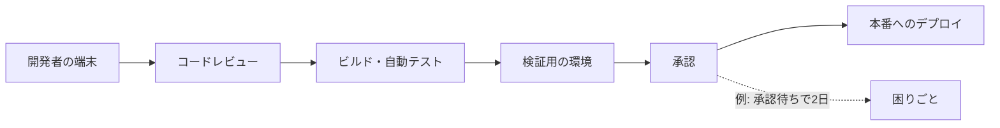

# Path-to-production mapping（本番までの道のりの見える化）

> 非公式の解説です（Thoughtworks とは関係がありません）。Claude Code（AI）が作成しました。状態が「公開承認済み」の解説は人が公開を承認していますが、内容の正確さを人が個別に確かめてはいません。「下書き」の解説は承認前の作成中のものです。詳しくは [README](../../README.md) を参照してください。

| 項目 | 内容 |
|---|---|
| 版 | Technology Radar Vol.35（2026年11月） |
| 象限 | Techniques（開発や運用の進め方・手法） |
| リング | Adopt（2022年10月の版でも Adopt。今回あらためて取り上げられた） |
| 状態 | 下書き |

## 1. 一言でいうと

Path-to-production mapping は、開発者が自分の端末でコードを書いてから、それが**本番環境**（利用者が実際に使う環境）で動くまでの全部の手順を、関係者が集まって1枚の図に書き出し、どこで時間がかかっているか・どこに困りごとがあるかを見つける手法です。

たとえるなら、荷物が倉庫から家に届くまでの道のりを全部書き出して、「この中継所で3日も止まっている」と気づくようなものです。荷物を速く包む（コードを速く書く）だけでは、届くのは速くなりません。

## 2. 解決する課題（なぜ生まれたか）

ソフトウェアは、書いただけでは利用者に届きません。一般に、コードの確認（レビュー）、テスト、ビルド、検証用の環境での確認、承認、本番への**デプロイ**（配置）など、たくさんの手順を通ります。それぞれの手順は別のチームや別の道具が担っていることが多く、**全体を見渡せている人はほとんどいません**。DORA（ソフトウェアの届け方を研究するプログラム）も、価値の流れ全体を見渡せている人はおらず、ほかの部分で起きていることに驚くことが多い、と述べています（[DORA: 価値の流れの見える化](https://dora.dev/capabilities/work-visibility-in-value-stream/)）。

その結果、次のようなことが起きます。

- 承認待ちや、検証用の環境の空き待ちなど、**待ち時間**が気づかれないまま積み重なる
- 一部の手順だけを速くしても、本当の詰まり（**ボトルネック**）が別の場所にあるので、全体は速くならない
- 手作業の手順や、チームによって違うやり方が、事故の原因になる

Thoughtworks は、AI でコードを書く速さが上がった今、この問題がより重要になったと見ています。コードを書く部分が速くなると、ほかの手順の詰まりがかえって目立つからです（[Radar のページ](https://www.thoughtworks.com/en-us/radar/techniques/path-to-production-mapping)）。

## 3. 仕組みの概要

**もとになる考え方**は、製造業の**バリューストリームマッピング**です。製品が注文から届くまでの、モノと情報の流れの全部の手順を図にして、むだを見つけて取り除くための道具で、トヨタが生み出しました。今の状態の図（現状マップ）を先に作り、次に目指す状態の図（将来マップ）を作るのが基本です（[Lean Enterprise Institute](https://www.lean.org/lexicon-terms/value-stream-mapping/)）。

**ワークショップの進め方**

1. ソフトウェアを作る人から動かし続ける人まで、本番までの道のりに関わる人が集まる（Radar）
2. ホワイトボード（またはオンラインの共有ボード）に、新しいコードの変更が開発者の端末から本番に届くまでの手順を、順番に並べる（Radar、caroli.org）
3. 手順ごとに、関わる人・使う道具・作業・できあがるものを書き添える（caroli.org）
4. 困りごと（遅れ、危うさ、やり方のばらつき）を書き出す（Radar）
5. 詰まりの大きいところから直していく。DORA も、何日もかかる流れの中で数分を縮めても効果は小さいとして、大きな待ちに目を向けるよう勧めています（[DORA: 価値の流れの管理](https://dora.dev/guides/value-stream-management/)）

出典: [Radar のページ](https://www.thoughtworks.com/en-us/radar/techniques/path-to-production-mapping)、[Paulo Caroli: Path to production](https://caroli.org/en/path-to-production/)

（図の手順と困りごとは説明のための例です）

**何を測るか**: DORA は、手順ごとに、作業を受け取ってから次に渡すまでの時間（リードタイム）と、邪魔が入らなければかかる正味の時間（プロセスタイム）を記録するよう勧めています。2つの定義から、その差がおおよその待ち時間になります（[DORA: 価値の流れの見える化](https://dora.dev/capabilities/work-visibility-in-value-stream/)）。数字は大まかで足りる、ともしています（[DORA: 価値の流れの管理](https://dora.dev/guides/value-stream-management/)）。

## 4. アーキテクチャ上の位置づけとトレードオフ

**位置づけ**: 道具や技術そのものではなく、ソフトウェアを届ける仕組み全体（**デプロイメントパイプライン**と、その周りの人の手順）を改善するための、出発点となる手法です。Martin Fowler も、デプロイメントパイプラインを作るときは、まず今の届け方をパイプラインとして描き出し、詰まりや自動化できる場所を探すよう勧めています（[Martin Fowler: Deployment Pipeline](https://martinfowler.com/bliki/DeploymentPipeline.html)）。

アーキテクトにとっては、**継続的デリバリー**（いつでも安全に本番へ出せる状態を保つこと）を実現するための設計の課題を見つける場にもなります。たとえば、部品どうしの結合が強く、まとめて出すための調整が必要になる、自動化を考えずに作られた部品がある、といった問題は、図にすると見えてくることがあります（筆者の見立て。DORA はこれらを、自動化を妨げる要因として挙げています〈[DORA: デプロイの自動化](https://dora.dev/capabilities/deployment-automation/)〉）。

**代わりに失うもの・注意点**

- **全員の時間**: 関係者全員が集まる必要があり、準備と調整の手間がかかります
- **図はすぐ古くなる**: 手順は変わっていくので、定期的に（たとえば半年ごとに）やり直す必要があります（[DORA](https://dora.dev/capabilities/work-visibility-in-value-stream/)）
- **一部だけを描く落とし穴**: 流れの一部だけを描くと、部分最適に陥ります。また、詰まりでない場所を改善しても、全体の時間はほとんど変わりません（同じページ）
- **変える権限が要る**: 参加者に手順を変える権限が無いと、図を作って終わりになりがちです（同じページ）
- **完璧を求めない**: 最初から正確な図や細かい数字を求めると、肝心の話し合いが進まなくなります（[DORA: 価値の流れの管理](https://dora.dev/guides/value-stream-management/)）

## 5. 採用を判断するときの観点

- **誰を呼ぶか**: 開発・テスト・運用・セキュリティ・承認者など、本番までの道のりに関わる全員。DORA は、すべてのチームの代表が参加することが欠かせないとしています（[DORA: 継続的デリバリー](https://dora.dev/capabilities/continuous-delivery/)）。抜けた役割の手順は図に出てこないためです（筆者の補足）
- **どこからどこまでを描くか**: 「開発者の端末から本番まで」を基本に、1つの変更が通る道のりを描く
- **何を指標にするか**: 改善の効果を測るには、DORA の5つの指標（変更のリードタイム、デプロイの頻度、失敗したデプロイからの復旧時間、変更の失敗率、デプロイのやり直し率）が使えます（[DORA の指標](https://dora.dev/guides/dora-metrics/)）。ただし、指標そのものを目標にすると、数字だけをよく見せる行動を招くと DORA は注意しています（同じページ）
- **AI 時代の観点**: AI でコードを書く速さが上がったなら、それに見合ってレビュー・テスト・デプロイの側も速くなっているかを確かめる（Thoughtworks の指摘による）
- **改善の続け方**: 図を作って終わりにせず、壁や共有の場所に置いて、改善のたびに更新する（2022年の Radar の説明も、図を継続的な改善に使い続けることを挙げています）

## 6. 関連技術・代替技術

- **バリューストリームマッピング**: この手法のもとになった、製造業の手法（第3節）
- **継続的デリバリー（CD）**: ソフトウェアの変更を、安全に素早く、いつでも本番に届けられる状態を保つ考え方（[continuousdelivery.com](https://continuousdelivery.com/)、[Martin Fowler: Continuous Delivery](https://martinfowler.com/bliki/ContinuousDelivery.html)）
- **デプロイメントパイプライン**: 変更を本番まで自動で運ぶ仕組み。段階ごとに確信を高めていく（[Martin Fowler](https://martinfowler.com/bliki/DeploymentPipeline.html)）
- **DORA の指標**: ソフトウェアを届ける力を測る指標の組（第5節）

## 7. Radar での扱い

- Vol.35（2026年11月）: **Adopt**。Radar のページは、新規か移動かを明記していません
- 過去の版: 2022年10月の版で Adopt。そのときの説明では、Thoughtworks の中ではほぼ誰もが行ってきたやり方だとしています
- Thoughtworks の評価の要旨: 社内では標準的なやり方だとしたうえで、AI でコードを書く速さが上がると、本番までの道のりのほかの場所の詰まりが目立ったり、ひどくなったりします。そのため、コードを書く速さだけでなく、端から端までの流れを改善することが大事で、そのための手法として、あらためて重要になったと見ています
- Radar のページ: https://www.thoughtworks.com/en-us/radar/techniques/path-to-production-mapping

## 8. 深掘りするときの一次情報

- [DORA: 価値の流れの見える化](https://dora.dev/capabilities/work-visibility-in-value-stream/) ／ [価値の流れの管理](https://dora.dev/guides/value-stream-management/) ／ [DORA の指標](https://dora.dev/guides/dora-metrics/)
- [Lean Enterprise Institute: Value-Stream Mapping](https://www.lean.org/lexicon-terms/value-stream-mapping/)
- [Paulo Caroli: Path to production](https://caroli.org/en/path-to-production/)
- [Martin Fowler: Deployment Pipeline](https://martinfowler.com/bliki/DeploymentPipeline.html)

## 9. 確認日

- 内容の確認日: 2026-11-08
- Radar の評価の確認日: 2026-11-08

## 用語集

| 用語 | 説明 |
|---|---|
| 本番環境 | 利用者が実際に使っている環境。これに対し、開発や検証のための環境がある |
| デプロイ | 作ったソフトウェアを、サーバーなどの動かす場所に配置して使える状態にすること |
| ビルド | ソースコードを、動かせる形（実行できるファイルなど）に組み立てること |
| コードレビュー | 書いたコードを、ほかの人が読んで確かめること |
| ボトルネック | 全体の流れの中で、いちばん詰まっている場所。ここを直さないと全体は速くならない |
| バリューストリームマッピング | 製品やサービスが顧客に届くまでの手順と、モノ・情報の流れを図にして、むだを見つける手法 |
| リードタイム | 作業を受け取ってから、次に渡す（または完成する）までにかかる時間。待ち時間を含む |
| プロセスタイム | 邪魔が入らず、必要なものがそろっていれば、作業にかかる正味の時間 |
| 継続的デリバリー（CD） | ソフトウェアの変更を、いつでも安全に素早く本番に出せる状態を保つ考え方と、そのための取り組み |
| デプロイメントパイプライン | コードの変更を、ビルド・テスト・検証を経て本番まで運ぶ一連の自動化された流れ |
| DORA | ソフトウェアを届ける力について調査・研究しているプログラム。その成果の指標がよく使われる |
| ワークショップ | 関係者が集まり、手を動かしながら一緒に考えたり決めたりする会 |
| 部分最適 | 全体ではなく一部だけをよくしようとして、全体としては改善しない（または悪くなる）こと |
