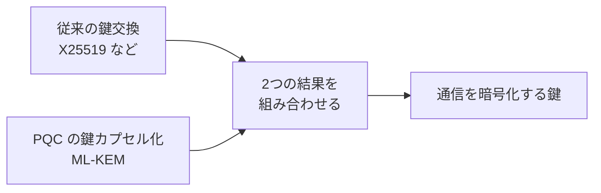

# Post-quantum cryptography（耐量子計算機暗号）

> 非公式の解説です（Thoughtworks とは関係がありません）。Claude Code（AI）が作成しました。状態が「公開承認済み」の解説は人が公開を承認していますが、内容の正確さを人が個別に確かめてはいません。「下書き」の解説は承認前の作成中のものです。詳しくは [README](../../README.md) を参照してください。

| 項目 | 内容 |
|---|---|
| 版 | Technology Radar Vol.35（2026年11月） |
| 象限 | Techniques（開発や運用の進め方・手法） |
| リング | Adopt（新規か移動かは Radar のページに明記なし） |
| 状態 | 下書き |

## 1. 一言でいうと

Post-quantum cryptography（PQC、耐量子計算機暗号）は、将来の高性能な**量子コンピュータ**でも破られないように設計された、新しい暗号の方式です。そして、今使っている暗号からこの新しい暗号へ、計画的に切り替えていく取り組みを指します。

注意したいのは、PQC は量子の物理現象を使う「量子暗号」とは別物だという点です。PQC は、今のコンピュータで動く普通の数学の暗号で、量子コンピュータでも解きにくい問題を土台にしています（[NIST: What Is Post-Quantum Cryptography?](https://www.nist.gov/cybersecurity/what-post-quantum-cryptography)）。

## 2. 解決する課題（なぜ生まれたか）

インターネットの安全は、**公開鍵暗号**（RSA や楕円曲線暗号など）に支えられています。Web サイトとの通信を暗号化するときの鍵の受け渡しや、文書やソフトウェアが本物であることを示す**電子署名**に使われています。

公開鍵暗号の安全性は、「大きな数の素因数分解」のような、今のコンピュータでは現実的な時間で解けない数学の問題に頼っています。ところが、十分に強力な量子コンピュータは、こうした問題を桁違いに速く解けると考えられています。NIST（米国の標準化機関）は、そのような量子コンピュータが現れれば、今広く使われている暗号の多くが破られるとしています（[NIST](https://www.nist.gov/cybersecurity/what-post-quantum-cryptography)、[CISA](https://www.cisa.gov/quantum)）。

「まだそんな量子コンピュータは無いのだから、急がなくてよいのでは」と思うかもしれません。急ぐべき理由は2つあります。

- **今盗んで、あとで解読する（harvest now, decrypt later）**: 攻撃者が、暗号化された通信を今のうちに記録しておき、量子コンピュータができたときに解読する、という手口です。何年も価値を持ち続ける秘密（医療・金融・国家の情報など）は、今記録されて将来解読されるおそれがあります（[NIST](https://www.nist.gov/cybersecurity/what-post-quantum-cryptography)）
- **切り替えに時間がかかる**: NIST は、暗号の標準ができてからシステムに行き渡るまで、過去の例で10〜20年かかったとしています。一方で、量子コンピュータが現れる時期の専門家の見積もりは、数年後から数十年後まで幅があります（同じページ）

## 3. 仕組みの概要

**NIST の標準**: NIST は2024年8月に、最初の3つの PQC の標準を公開しました。

| 標準 | 名前 | 役割 | 土台の数学 |
|---|---|---|---|
| FIPS 203 | ML-KEM | **鍵カプセル化**（通信の両側で共通の秘密の鍵を安全に共有する） | 格子（Module-LWE） |
| FIPS 204 | ML-DSA | 電子署名 | 格子 |
| FIPS 205 | SLH-DSA | 電子署名 | ハッシュ関数 |

（[FIPS 203](https://csrc.nist.gov/pubs/fips/203/final)、[FIPS 204](https://csrc.nist.gov/pubs/fips/204/final)、[FIPS 205](https://csrc.nist.gov/pubs/fips/205/final)）

このほか、鍵カプセル化の2つめの方式として HQC が選ばれ、標準化が進んでいます（[NIST: HQC](https://csrc.nist.gov/news/2025/hqc-announced-as-a-4th-round-selection)）。

**ハイブリッド方式**: 新しい暗号はまだ実績が浅いと考えられているため、移行の途中では、従来の暗号と PQC を**組み合わせて**使う方式がよく使われます。たとえば、通信の暗号化の規格 TLS 1.3 では、従来の鍵交換（X25519 など）と ML-KEM を組み合わせる方式が、IETF の規格（RFC 10024）として定められました。どちらか一方が安全である限り、全体の安全が保たれる、という考え方です（[RFC 10024（草案のページ）](https://datatracker.ietf.org/doc/draft-ietf-tls-ecdhe-mlkem/)）。英国の NCSC によると、主要なブラウザのいくつかは、すでにこのような組み合わせに対応しています（[NCSC](https://www.ncsc.gov.uk/guidance/pqc-migration-timelines)）。

**移行の期限**: NIST は、量子コンピュータに弱い方式を2035年までに標準から外し、危険の大きいシステムはもっと早く移すとしています（[NIST PQC プロジェクト](https://csrc.nist.gov/projects/post-quantum-cryptography)）。NCSC は、2028年までに現状の把握と計画、2031年までに優先度の高い移行、2035年までにすべての移行を終える、という目安を示しています（[NCSC](https://www.ncsc.gov.uk/guidance/pqc-migration-timelines)）。

## 4. アーキテクチャ上の位置づけとトレードオフ

**位置づけ**: 暗号は、通信（TLS）、認証、電子署名、保存データの暗号化など、システムのあらゆる層に入り込んでいます。そのため PQC への移行は、1つのライブラリの更新ではなく、**システム全体の棚卸しと計画**が要る取り組みです。

アーキテクトにとって大事なのが**クリプトアジリティ**（暗号の方式を、システムを作り直さずに差し替えられる設計）です。NCSC も、別の方式に切り替えられる仕組みを選ぶよう勧めています（[NCSC](https://www.ncsc.gov.uk/guidance/pqc-migration-timelines)）。

**代わりに失うもの・難しさ**

- **データが大きくなる**: PQC の鍵や暗号文は、従来より大きくなりがちです。たとえば、TLS のハイブリッド方式（X25519MLKEM768）では、接続の最初に送る鍵のデータが約1.2KB になります（従来の X25519 だけなら32バイト）（[RFC 10024（草案のページ）](https://datatracker.ietf.org/doc/draft-ietf-tls-ecdhe-mlkem/)）
- **性能**: NCSC は、計算を速くするハードウェアの対応が進み、2026〜27年ごろに効率がよくなる見込みを示していました（ページの公開時点の見通し）（[NCSC](https://www.ncsc.gov.uk/guidance/pqc-migration-timelines)）
- **古い機器・作り直せない機器**: 工場の機器などの IoT 機器は、性能が低かったり、更新できなかったり、独自の通信方式を使っていたりして、移行が難しいことがあります（同じページ）
- **相互運用**: 移行の期間中は、新旧両方の方式に対応する必要があります。NCSC は、Web の証明書の仕組み（WebPKI）と産業用の制御システムを、特に難しい分野に挙げています（同じページ）
- **気づかない後退**: PQC に対応したつもりでも、相手が対応していないと、黙って従来の暗号に戻ってしまう（フォールバックする）ことがあります。実際に PQC が使われているかを確かめる必要があります（同じページ）

## 5. 採用を判断するときの観点

- **新しいシステムでは最初から**: Thoughtworks は、新しく作るシステムでは、量子コンピュータに耐える暗号を必須にするよう勧めています（[Radar のページ](https://www.thoughtworks.com/en-us/radar/techniques/post-quantum-cryptography)）
- **暗号の棚卸し**: どのシステムが、どこで、どんな暗号を使っているかを洗い出す。あわせて、扱うデータが何年守られる必要があるかを確かめる（[NCSC](https://www.ncsc.gov.uk/guidance/pqc-migration-timelines)、[NIST](https://www.nist.gov/cybersecurity/what-post-quantum-cryptography)）
- **優先順位**: 長く価値を持つデータを扱うサービスから移す。急ぐのは鍵の受け渡し（鍵交換）。Thoughtworks も、鍵交換の移行が最も急ぐとしています（Radar のページ）
- **使っている道具の対応状況**: 言語やフレームワーク、ライブラリの最新版には PQC の対応が入りつつあります。古い版からの更新や設定の変更が要ることがあります（Radar のページ）。暗号を自分で実装せず、認証を受けた実装や信頼できるライブラリを使う（[NCSC](https://www.ncsc.gov.uk/guidance/pqc-migration-timelines)）
- **取引先への確認**: 使っている製品やクラウドの事業者に、PQC への対応の計画を確かめる。調達の要件に入れる（[NCSC](https://www.ncsc.gov.uk/guidance/pqc-migration-timelines)、[CISA](https://www.cisa.gov/resources-tools/resources/preparing-post-quantum-era-call-action)）

## 6. 関連技術・代替技術

- **Java post-quantum cryptography**: Java（JDK 24 以降）での PQC の対応。Radar では Languages & Frameworks の Assess（2025年11月）に置かれていた（Radar のページの関連項目による）
- **量子暗号**: 量子の物理現象を使う暗号。PQC とは別のもの（[NIST](https://www.nist.gov/cybersecurity/what-post-quantum-cryptography)）
- **TLS 1.3**: Web などの通信を暗号化する規格。ハイブリッド方式の PQC が組み込まれつつある（第3節）

## 7. Radar での扱い

- Vol.35（2026年11月）: **Adopt**。Radar のページは、新規か移動かを明記していません
- 過去の版: Radar のページの推移には、今回の版だけが載っています
- Thoughtworks の評価の要旨: 今の暗号化データを記録しておき将来解読する脅威があるため、特に鍵交換の移行を急ぐべきだと見ています。NIST の標準が確定し、各国の政府が2030〜2035年の移行を目標にしていること、言語やフレームワークの対応も進んでいることを挙げ、新しいシステムでは必須にし、既存のシステムでは移行の計画を前倒しするよう勧めています
- Radar のページ: https://www.thoughtworks.com/en-us/radar/techniques/post-quantum-cryptography

## 8. 深掘りするときの一次情報

- [NIST: What Is Post-Quantum Cryptography?](https://www.nist.gov/cybersecurity/what-post-quantum-cryptography)
- [NIST: FIPS 203](https://csrc.nist.gov/pubs/fips/203/final) ／ [FIPS 204](https://csrc.nist.gov/pubs/fips/204/final) ／ [FIPS 205](https://csrc.nist.gov/pubs/fips/205/final)
- [NIST IR 8547: Transition to Post-Quantum Cryptography Standards](https://csrc.nist.gov/pubs/ir/8547/final)
- [NCSC: Timelines for migration to post-quantum cryptography](https://www.ncsc.gov.uk/guidance/pqc-migration-timelines)
- [CISA: Post-Quantum Cryptography Initiative](https://www.cisa.gov/quantum)
- [RFC 10024: TLS 1.3 のハイブリッドの鍵合意](https://datatracker.ietf.org/doc/draft-ietf-tls-ecdhe-mlkem/)（リンク先は草案のページ。そのページで RFC 10024 として発行済みであることを確認）

## 9. 確認日

- 内容の確認日: 2026-11-08
- Radar の評価の確認日: 2026-11-08

## 用語集

| 用語 | 説明 |
|---|---|
| 量子コンピュータ | 量子力学の性質を使って計算するコンピュータ。特定の種類の問題を、今のコンピュータより桁違いに速く解けると考えられている |
| 公開鍵暗号 | 公開してよい鍵と秘密の鍵の組を使う暗号。鍵の受け渡しや電子署名に使われる。RSA や楕円曲線暗号が代表例 |
| 電子署名 | データが本人によって作られ、改ざんされていないことを、暗号の技術で証明する仕組み |
| 鍵交換・鍵カプセル化 | 通信する両者が、盗み見られても安全な方法で、共通の秘密の鍵を共有する仕組み。鍵カプセル化（KEM）はその方式の一つ |
| 格子・ハッシュ関数 | PQC の土台になる数学。格子は多次元の空間に規則正しく並んだ点にかかわる、解くのが難しい問題、ハッシュ関数はデータから固定長の要約値を作る関数（一般的な説明） |
| NIST | 米国の国立標準技術研究所。暗号の標準（FIPS）を定めている |
| FIPS | NIST が定める米国政府向けの情報処理の標準 |
| NCSC・CISA | NCSC は英国の、CISA は米国の、サイバーセキュリティを担う政府機関 |
| TLS | Web サイトとの通信などを暗号化する規格。URL が https で始まる通信で使われる |
| IETF・RFC | IETF はインターネットの技術の標準を作る団体で、RFC はその文書 |
| ハイブリッド方式 | 従来の暗号と PQC を組み合わせて使う方式。どちらかが破られても、もう一方で安全を保つ |
| クリプトアジリティ | 暗号の方式を、システムを大きく作り直さずに差し替えられるようにしておく設計 |
| フォールバック | 新しい方式が使えないときに、黙って古い方式に戻ってしまうこと |
| IoT | インターネットにつながる機器（センサーや工場の機械など） |
