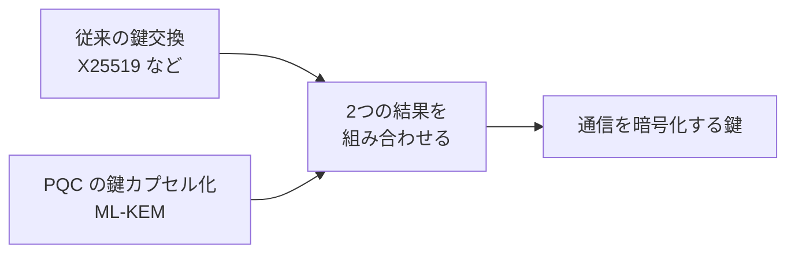

# Post-quantum cryptography（耐量子計算機暗号）

> 非公式の解説です（Thoughtworks とは関係がありません）。Claude Code（AI）が作成しました。状態が「公開承認済み」の解説は人が公開を承認していますが、内容の正確さを人が個別に確かめてはいません。「下書き」の解説は承認前の作成中のものです。詳しくは [README](../../README.md) を参照してください。

| 項目 | 内容 |
|---|---|
| 版 | Technology Radar Vol.35（2026年11月） |
| 象限 | Techniques（開発や運用の進め方・手法） |
| リング | Adopt（新規か移動かは Radar のページに明記なし） |
| 状態 | 下書き |
| 図解ページ | [図と動きで見る図解ページ](post-quantum-cryptography-intro.html)（この解説の内容を図と動きで見せるページ。サイトで表示。GitHub のリポジトリではソースが表示されます） |

## 1. 一言でいうと

**名前の手がかり**: Post〈〜の後〉-quantum〈量子〉＋ cryptography〈暗号の技術。ギリシャ語の「隠された」＋「書くこと」〉。量子コンピュータの時代の後も使える暗号

Post-quantum cryptography（PQC、耐量子計算機暗号）は、将来の高性能な**量子コンピュータ**でも破られないように設計された、新しい暗号の方式です。そして、今使っている暗号からこの新しい暗号へ、計画的に切り替えていく取り組みを指します。

注意したいのは、PQC は量子の物理現象を使う「量子暗号」とは別物だという点です。PQC は、今のコンピュータで動く普通の数学の暗号で、従来のコンピュータでも量子コンピュータでも解きにくい問題を土台にしています（[NIST: What Is Post-Quantum Cryptography?](https://www.nist.gov/cybersecurity/what-post-quantum-cryptography)）。

## 2. 解決する課題（なぜ生まれたか）

インターネットの安全は、**公開鍵暗号**（RSA や楕円曲線暗号など）に支えられています。Web サイトとの通信を暗号化するときの鍵の受け渡しや、文書やソフトウェアが本物であることを示す**電子署名**に使われています。

公開鍵暗号の安全性は、「大きな数の素因数分解」のような、今のコンピュータでは現実的な時間で解けない数学の問題に頼っています。ところが、十分に強力な量子コンピュータは、こうした問題を桁違いに速く解けると考えられています。NIST（米国の標準化機関）は、そのような量子コンピュータが現れれば、今広く使われている暗号の多くが破られうるとしています（[NIST](https://www.nist.gov/cybersecurity/what-post-quantum-cryptography)、[CISA](https://www.cisa.gov/quantum)）。

「まだそんな量子コンピュータは無いのだから、急がなくてよいのでは」と思うかもしれません。急ぐべき理由は2つあります。

- **今盗んで、あとで解読する（harvest now, decrypt later）**: 攻撃者が、暗号化された通信を今のうちに記録しておき、量子コンピュータができたときに解読する、という手口です。何年も価値を持ち続ける秘密（医療・金融・国家の情報など）は、今記録されて将来解読されるおそれがあります（[NIST](https://www.nist.gov/cybersecurity/what-post-quantum-cryptography)）。傍受して保存しておくところまでは、量子コンピュータが無い今でも行えます。そのため、長く価値を持つ秘密は、量子コンピュータがいつ現れるかに関わらず、従来の暗号のまま記録された時点で、すでに危険にさらされていると考えられます。現れる時期が変えるのは、いつ解読されうるかだけです（筆者の見立て）
- **切り替えに時間がかかる**: NIST は、暗号の標準ができてからシステムに行き渡るまで、過去の例で10〜20年かかったとしています。一方で、量子コンピュータが現れる時期の専門家の見積もりは、数年後から数十年後まで幅があります（同じページ）

## 3. 仕組みの概要

### 課題ごとの答え

| 課題 | PQC の答え |
|---|---|
| 量子コンピュータが現れると、今の公開鍵暗号の多くが破られる | 量子コンピュータでも解きにくいと考えられている数学の問題（格子・ハッシュ関数など）を土台にした、新しい方式に置き換える。今のコンピュータで動く普通の暗号なので、特別な機器は要らない。NIST は2024年8月に最初の3つの標準（ML-KEM・ML-DSA・SLH-DSA）を公開した（[NIST](https://www.nist.gov/cybersecurity/what-post-quantum-cryptography)、[FIPS 203](https://csrc.nist.gov/pubs/fips/203/final)） |
| 今盗んで、あとで解読される | いちばん急ぐのは鍵の受け渡し（鍵交換）。今の通信の鍵交換を PQC（移行の途中では従来の方式と組み合わせたハイブリッド方式。[RFC 10024（草案のページ）](https://datatracker.ietf.org/doc/draft-ietf-tls-ecdhe-mlkem/)）にすれば、切り替えた後に記録された通信は、あとで量子コンピュータで解読されにくくなる。切り替える前に記録された通信は、あとから守れないので、早く切り替えるほど守れる範囲が広い（筆者の見立て。相手も PQC に対応している場合に限る。第4節のフォールバックを参照）。Thoughtworks は鍵交換の移行が最も急ぐとしている（[Radar のページ](https://www.thoughtworks.com/en-us/radar/techniques/post-quantum-cryptography)）。AWS のドキュメントも、PQC で長期の機密性を守ると説明している（[AWS KMS の耐量子の鍵](https://docs.aws.amazon.com/kms/latest/developerguide/mldsa.html)） |
| 切り替えに10〜20年かかる | 期限から逆算して計画的に移る。まず暗号の使い道を棚卸しし、守る期間の長いデータから移す。NCSC は2028年・2031年・2035年の段階の目安を示し、NIST は弱い方式を2035年までに標準から外すとしている。方式を差し替えやすい設計（クリプトアジリティ）にしておく（[NCSC](https://www.ncsc.gov.uk/guidance/pqc-migration-timelines)、[NIST PQC プロジェクト](https://csrc.nist.gov/projects/post-quantum-cryptography)） |

### 仕組み

**NIST の標準**: NIST は2024年8月に、最初の3つの PQC の標準を公開しました。

| 標準 | 名前 | 役割 | 土台の数学 |
|---|---|---|---|
| FIPS 203 | ML-KEM | **鍵カプセル化**（通信の両側で共通の秘密の鍵を安全に共有する） | 格子（Module-LWE） |
| FIPS 204 | ML-DSA | 電子署名 | 格子 |
| FIPS 205 | SLH-DSA | 電子署名 | ハッシュ関数 |

（[FIPS 203](https://csrc.nist.gov/pubs/fips/203/final)、[FIPS 204](https://csrc.nist.gov/pubs/fips/204/final)、[FIPS 205](https://csrc.nist.gov/pubs/fips/205/final)）

このほか、鍵カプセル化の2つめの方式として HQC が選ばれ、標準化が進んでいます（[NIST: HQC](https://csrc.nist.gov/news/2025/hqc-announced-as-a-4th-round-selection)）。

**ハイブリッド方式**: 新しい暗号はまだ実績が浅いため（筆者の見立て）、移行の途中では、従来の暗号と PQC を**組み合わせて**使う方式がよく使われます。たとえば、通信の暗号化の規格 TLS 1.3 では、従来の鍵交換（X25519 など）と ML-KEM を組み合わせる方式が、IETF の規格（RFC 10024）として定められました。どちらか一方が安全である限り、全体の安全が保たれる、という考え方です（[RFC 10024（草案のページ）](https://datatracker.ietf.org/doc/draft-ietf-tls-ecdhe-mlkem/)）。英国の NCSC によると、主要なブラウザのいくつかは、すでにこのような組み合わせに対応しています（[NCSC](https://www.ncsc.gov.uk/guidance/pqc-migration-timelines)。ページの公開時点〈2025年3月〉の記述）。

**移行の期限**: NIST は、量子コンピュータに弱い方式を2035年までに標準から外し、危険の大きいシステムはもっと早く移すとしています（[NIST PQC プロジェクト](https://csrc.nist.gov/projects/post-quantum-cryptography)）。NCSC は、2028年までに現状の把握と計画、2031年までに優先度の高い移行、2035年までにすべての移行を終える、という目安を示しています（[NCSC](https://www.ncsc.gov.uk/guidance/pqc-migration-timelines)）。

## 4. アーキテクチャ上の位置づけとトレードオフ

**位置づけ**: 暗号は、通信（TLS）、認証、電子署名、保存データの暗号化など、システムのあらゆる層に入り込んでいます。そのため PQC への移行は、1つのライブラリの更新ではなく、**システム全体の棚卸しと計画**が要る取り組みです。

アーキテクトにとって大事なのが**クリプトアジリティ**（暗号の方式を、システムを作り直さずに差し替えられる設計）です。NCSC も、別の方式に切り替えられる仕組みを選ぶよう勧めています（[NCSC](https://www.ncsc.gov.uk/guidance/pqc-migration-timelines)）。

**代わりに失うもの・難しさ**

- **データが大きくなる**: PQC の鍵や暗号文は、従来より大きくなりがちです。たとえば、TLS のハイブリッド方式（X25519MLKEM768）では、接続の最初に送る鍵のデータが約1.2KB になります（従来の X25519 だけなら32バイト）（[RFC 10024（草案のページ）](https://datatracker.ietf.org/doc/draft-ietf-tls-ecdhe-mlkem/)）
- **性能**: NCSC は、計算を速くするハードウェアの対応が進み、2026〜27年ごろに効率がよくなる見込みを示していました（ページの公開時点の見通し）（[NCSC](https://www.ncsc.gov.uk/guidance/pqc-migration-timelines)）
- **古い機器・作り直せない機器**: 工場の機器などの IoT 機器は、性能が低かったり、更新できなかったり、独自の通信方式を使っていたりして、移行が難しいことがあります（同じページ）
- **相互運用**: 移行の期間中は、新旧両方の方式に対応する必要があります。NCSC は、Web の証明書の仕組み（WebPKI）と産業用の制御システムを、特に難しい分野に挙げています（同じページ）
- **気づかない後退**: PQC に対応したつもりでも、相手が対応していないと、黙って従来の暗号に戻ってしまう（フォールバックする）ことがあります。実際に PQC が使われているかを確かめる必要があります（同じページ）

## 5. 採用を判断するときの観点

- **新しいシステムでは最初から**: Thoughtworks は、新しく作るシステムでは、量子コンピュータに耐える暗号を必須にするよう勧めています（[Radar のページ](https://www.thoughtworks.com/en-us/radar/techniques/post-quantum-cryptography)）
- **暗号の棚卸し**: どのシステムが、どこで、どんな暗号を使っているかを洗い出す。あわせて、扱うデータが何年守られる必要があるかを確かめる（[NCSC](https://www.ncsc.gov.uk/guidance/pqc-migration-timelines)、[NIST](https://www.nist.gov/cybersecurity/what-post-quantum-cryptography)）
- **優先順位**: 長く価値を持つデータを扱うサービスから移す。急ぐのは鍵の受け渡し（鍵交換）。Thoughtworks も、鍵交換の移行が最も急ぐとしています（Radar のページ）
- **使っている道具の対応状況**: 言語やフレームワーク、ライブラリの最新版には PQC の対応が入りつつあります。古い版からの更新や設定の変更が要ることがあります（Radar のページ）。暗号を自分で実装せず、認証を受けた実装や信頼できるライブラリを使う（[NCSC](https://www.ncsc.gov.uk/guidance/pqc-migration-timelines)）
- **取引先への確認**: 使っている製品やクラウドの事業者に、PQC への対応の計画を確かめる。調達の要件に入れる（取引先への確認は [NCSC](https://www.ncsc.gov.uk/guidance/pqc-migration-timelines)。調達の要件に入れることは、CISA のページに載った G7 のサイバーセキュリティの作業部会の呼びかけも、優先事項の一つに挙げている〈[Preparing for the post-quantum era](https://www.cisa.gov/resources-tools/resources/preparing-post-quantum-era-call-action)〉）

## 6. 関連技術・代替技術

- **Java post-quantum cryptography**: Java（JDK 24 以降）での PQC の対応。Radar では Languages & Frameworks の Assess（2025年11月）に置かれていた（Radar のページの関連項目による）
- **量子暗号**: 量子の物理現象を使う暗号。PQC とは別のもの（[NIST](https://www.nist.gov/cybersecurity/what-post-quantum-cryptography)）
- **TLS 1.3**: Web などの通信を暗号化する規格。ハイブリッド方式の PQC が組み込まれつつある（第3節）

### 実現するための道具の例

次は、PQC を使うための道具の例です（推奨でも網羅でもありません。2026-11-15 の時点のものです）。暗号は自分で実装せず、信頼できるライブラリやサービスを使います（第5節）。

| 名前 | 提供の形 | 何をするか |
|---|---|---|
| [OpenSSL](https://openssl-library.org/news/openssl-3.5-notes/) | OSS | 広く使われる暗号と TLS のライブラリ。3.5.0（2025年4月）から ML-KEM・ML-DSA・SLH-DSA に対応し、TLS の既定でハイブリッド方式を優先し、X25519MLKEM768 の鍵を最初から送る |
| [Go の crypto/mlkem](https://pkg.go.dev/crypto/mlkem) | OSS（BSD-3-Clause。Go の標準ライブラリ） | ML-KEM（ML-KEM-768 と ML-KEM-1024）の鍵カプセル化。多くの用途では ML-KEM-768 を勧めている |
| [liboqs（Open Quantum Safe）](https://github.com/open-quantum-safe/liboqs) | OSS（MIT） | PQC の方式を多数そろえた C のライブラリ。研究と試作のためのもので、本番環境や機微なデータの保護に使うことは勧めていない |
| [AWS KMS の耐量子の鍵](https://docs.aws.amazon.com/kms/latest/developerguide/mldsa.html) | 商用のクラウドのサービス | 鍵の管理のサービスで、ML-DSA（電子署名）と ML-KEM（鍵の確立）の鍵を作って使える |

## 7. Radar での扱い

- Vol.35（2026年11月）: **Adopt**。Radar のページは、新規か移動かを明記していません
- 過去の版: Radar のページの推移には、今回の版だけが載っています
- Thoughtworks の評価の要旨: 今の暗号化データを記録しておき将来解読する脅威があるため、特に鍵交換の移行を急ぐべきだと見ています。NIST の標準が確定し、各国の政府が2030〜2035年の移行を目標にしていること、言語やフレームワークの対応も進んでいることを挙げ、新しいシステムでは必須にし、既存のシステムでは移行の計画を前倒しするよう勧めています
- Radar のページ: https://www.thoughtworks.com/en-us/radar/techniques/post-quantum-cryptography

## 8. 深掘りするときの一次情報

- [NIST: What Is Post-Quantum Cryptography?](https://www.nist.gov/cybersecurity/what-post-quantum-cryptography)
- [NIST: FIPS 203](https://csrc.nist.gov/pubs/fips/203/final) ／ [FIPS 204](https://csrc.nist.gov/pubs/fips/204/final) ／ [FIPS 205](https://csrc.nist.gov/pubs/fips/205/final)
- [NIST IR 8547: Transition to Post-Quantum Cryptography Standards](https://csrc.nist.gov/pubs/ir/8547/final)
- [NCSC: Timelines for migration to post-quantum cryptography](https://www.ncsc.gov.uk/guidance/pqc-migration-timelines)
- [CISA: Post-Quantum Cryptography Initiative](https://www.cisa.gov/quantum)
- [RFC 10024: TLS 1.3 のハイブリッドの鍵合意](https://datatracker.ietf.org/doc/draft-ietf-tls-ecdhe-mlkem/)（リンク先は草案のページ。そのページで RFC 10024 として発行済みであることを確認）

## 9. 確認日

- 内容の確認日: 2026-11-15（2026-11-08 に書き、2026-11-15 に名前の手がかり・課題ごとの答え・道具の例・元の語を足して、全体を点検し直した）
- Radar の評価の確認日: 2026-11-15

## 用語集

用語の説明の冒頭の「元の語」は、覚えるための手がかりとして、元の語（英単語の意味・略語の元の綴り・名前の元になった語）を短く示したものです。

| 用語 | 説明 |
|---|---|
| 量子コンピュータ | 元の語: quantum〈量子。もとはラテン語の「どれだけの量」〉＋ computer〈計算するもの〉。量子力学の性質を使って計算するコンピュータ。特定の種類の問題を、今のコンピュータより桁違いに速く解けると考えられている |
| 公開鍵暗号 | 元の語: public key〈公開の鍵〉＋ cryptography〈暗号の技術〉。公開してよい鍵と秘密の鍵の組を使う暗号。鍵の受け渡しや電子署名に使われる。RSA や楕円曲線暗号が代表例 |
| 電子署名 | 元の語: digital signature〈電子の署名〉。データが本人によって作られ、改ざんされていないことを、暗号の技術で証明する仕組み |
| 鍵交換・鍵カプセル化 | 元の語: key exchange〈鍵の交換〉、KEM は Key Encapsulation Mechanism の略（鍵をカプセルに包む仕組み）。通信する両者が、盗み見られても安全な方法で、共通の秘密の鍵を共有する仕組み。鍵カプセル化（KEM）はその方式の一つ |
| 格子・ハッシュ関数 | 元の語: lattice〈格子〉、hash〈細かく刻む〉＋ function〈関数〉。PQC の土台になる数学。格子は多次元の空間に規則正しく並んだ点の集まりで、PQC はそれにかかわる解くのが難しい問題を使う。ハッシュ関数はデータから固定長の要約値を作る関数（一般的な説明） |
| NIST | 元の語: National Institute of Standards and Technology の略。米国の国立標準技術研究所。暗号の標準（FIPS）を定めている |
| FIPS | 元の語: Federal Information Processing Standards の略（連邦の情報処理の標準）。NIST が定める米国政府向けの情報処理の標準 |
| NCSC・CISA | 元の語: NCSC は National Cyber Security Centre の略、CISA は Cybersecurity and Infrastructure Security Agency の略。NCSC は英国の、CISA は米国の、サイバーセキュリティを担う政府機関 |
| TLS | 元の語: Transport Layer Security の略（通信を運ぶ層の安全）。Web サイトとの通信などを暗号化する規格。URL が https で始まる通信で使われる |
| IETF・RFC | 元の語: IETF は Internet Engineering Task Force の略、RFC は Request for Comments の略（意見を求める文書）。IETF はインターネットの技術の標準を作る団体で、RFC はその文書 |
| ハイブリッド方式 | 元の語: hybrid〈混ざったもの〉。従来の暗号と PQC を組み合わせて使う方式。どちらかが破られても、もう一方で安全を保つ |
| クリプトアジリティ | 元の語: crypto〈暗号〉＋ agility〈身軽さ〉。暗号の方式を、システムを大きく作り直さずに差し替えられるようにしておく設計 |
| フォールバック | 元の語: fall back〈後ろへ下がる〉。新しい方式が使えないときに、黙って古い方式に戻ってしまうこと |
| IoT | 元の語: Internet of Things の略（モノのインターネット）。インターネットにつながる機器（センサーや工場の機械など） |
