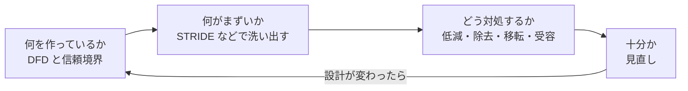

# Threat modeling（脅威モデリング）

> 非公式の解説です（Thoughtworks とは関係がありません）。Claude Code（AI）が作成しました。状態が「公開承認済み」の解説は人が公開を承認していますが、内容の正確さを人が個別に確かめてはいません。「下書き」の解説は承認前の作成中のものです。詳しくは [README](../../README.md) を参照してください。

| 項目 | 内容 |
|---|---|
| 版 | Technology Radar Vol.35（2026年11月） |
| 象限 | Techniques（開発や運用の進め方・手法） |
| リング | Adopt（新規か移動かは Radar のページに明記なし。直前に載った2025年4月の版でも Adopt） |
| 状態 | 下書き |

## 1. 一言でいうと

Threat modeling（脅威モデリング）は、作っているシステムの構成を図などで表し、「どこで、何が、どう悪用されうるか」をチームで洗い出して、対策を決める手法です。**コードを書いて検査する前に、設計の段階で弱点を見つける**のが特徴です。

たとえるなら、家を建てる前に間取り図を広げて、「この窓は道路から手が届く」「勝手口の鍵は誰が持つのか」と、泥棒の目で見て回るようなものです。建ててから鍵を付け替えるより、ずっと安く済みます。

## 2. 解決する課題（なぜ生まれたか）

セキュリティの対策というと、**脆弱性診断**（できあがったシステムに攻撃を試して弱点を探す検査）や、ソースコードを自動で調べるツールがまず思い浮かびます。これらは大切ですが、見つけられるのは主に「実装の誤り」です。「そもそもこの機能に、外部から誰でも呼べる入口があるのはおかしい」といった**設計の誤り**は、決まった規則で調べるツールでは見つけにくく、しかも見つかった時点では直す費用が大きくなっています（筆者の見立て）。Microsoft は、問題を早い段階で見つければ、比較的簡単に、費用も抑えて直せるとしています（[Microsoft: Threat Modeling Tool の脅威の分類](https://learn.microsoft.com/en-us/azure/security/develop/threat-modeling-tool-threats)）。

もう1つの課題は、セキュリティを「最後にまとめて確認するもの」にしてしまうことです。OWASP（Web のセキュリティに取り組む非営利の団体）の解説は、脅威モデリングを設計の段階など開発の早い時期に行うのが理想で、一度やって終わりではなく、システムとともに更新し続けるものだとしています（[OWASP: Threat Modeling Cheat Sheet](https://cheatsheetseries.owasp.org/cheatsheets/Threat_Modeling_Cheat_Sheet.html)）。

さらに最近は、**生成 AI** を組み込んだシステムが増え、従来とは違う種類の危険が加わりました。代表例が**プロンプトインジェクション**（AI への入力に紛れ込ませた文で、AI に本来の指示と違う動きをさせる攻撃）です。OWASP の LLM アプリ向けの危険の一覧（2025年版）では、これが1番目に挙がり、AI に権限を与えすぎる危険（Excessive Agency）なども並んでいます（[OWASP: Top 10 for LLM Applications 2025](https://genai.owasp.org/llm-top-10/)）。

## 3. 仕組みの概要

脅威モデリングには多くの流派がありますが、共通の骨組みとしてよく使われるのが、次の**4つの問い**です。実践者が2020年にまとめた Threat Modeling Manifesto（脅威モデリングの宣言）は、これを Adam Shostack の「4つの問い」の枠組みとして紹介しています（[Threat Modeling Manifesto](https://www.threatmodelingmanifesto.org/)、作成年は [OWASP Community: Threat Modeling](https://community.owasp.org/Threat_Modeling)）。

1. **何を作っているのか**: システムの構成を図にする。よく使われるのは**データフロー図**（DFD。データがどこから来て、どの処理を通り、どこに保存されるかを描いた図）です。特に大事なのが**信頼境界**（社外と社内、利用者の端末とサーバーなど、信頼の度合いが変わる境目）を描き込むことです（[OWASP: Threat Modeling Cheat Sheet](https://cheatsheetseries.owasp.org/cheatsheets/Threat_Modeling_Cheat_Sheet.html)）
2. **何がまずいことになりうるか**: 図の要素やデータの流れごとに、起こりうる脅威を挙げる
3. **それにどう対処するか**: 脅威ごとに、低減する・取り除く・他者に移す（保険や外部サービスなど）・受け入れる、のどれかを決める。OWASP は、他者に移してもリスク自体は減らないので、残ったリスクの持ち主を記録するよう注意しています（同上）
4. **十分にやれたか**: 図が実際の構成と合っているか、対策がテストできる形になっているかを見直す（同上）

2つめの問いで漏れなく考えるための道具が **STRIDE** です。Microsoft が広めた分類で、脅威を6つに分けます（[Microsoft: 脅威の分類](https://learn.microsoft.com/en-us/azure/security/develop/threat-modeling-tool-threats)、守る性質との対応は [OWASP: Threat Modeling Cheat Sheet](https://cheatsheetseries.owasp.org/cheatsheets/Threat_Modeling_Cheat_Sheet.html)）。

| 分類 | 意味 | 破られる性質 |
|---|---|---|
| Spoofing | なりすまし | 認証 |
| Tampering | 改ざん | 完全性 |
| Repudiation | 「やっていない」と言い逃れされる | 操作の記録と否認防止（OWASP は Accounting、Microsoft は Non-repudiation と呼ぶ） |
| Information disclosure | 情報漏えい | 機密性 |
| Denial of service | サービスを使えなくする | 可用性 |
| Elevation of privilege | 本来より強い権限を得る | 認可 |

**小さく、何度も行う**: martinfowler.com に載った、Thoughtworks の Jim Gumbley らによる手引き（2025年）は、システム全体を対象にした終日の会議は参加者が圧倒されて続かないとし、1つの機能など範囲を絞った短い会（簡易版なら15〜30分）を、スプリントの計画など普段の場に組み込むよう勧めています。見つけた対策は、バックログの項目や受け入れ基準として開発の計画に入れます。セキュリティの専門家がいなくても始められるとしています（[martinfowler.com: Threat Modeling Guide for Software Teams](https://martinfowler.com/articles/agile-threat-modelling.html)）。

## 4. アーキテクチャ上の位置づけとトレードオフ

**位置づけ**: 設計の判断に、セキュリティの観点を早い時期から入れるための手法です。脆弱性診断や自動のスキャンを置き換えるものではなく、それらが苦手な「設計の誤り」を受け持つ、補い合う関係にあります（筆者の見立て）。

**得られるもの**

- **手戻りの削減**: 早い段階で見つけた問題は、比較的簡単に、費用も抑えて直せる（[Microsoft](https://learn.microsoft.com/en-us/azure/security/develop/threat-modeling-tool-threats)）
- **共通理解**: Manifesto は、対話が共通の理解を生み、文書はそれを記録するものだとしています（[Threat Modeling Manifesto](https://www.threatmodelingmanifesto.org/)）
- **AI の扱いの線引き**: 生成 AI のどの振る舞いなら多少ぶれても許せ、どこは決まった規則で必ず止める仕組み（ガードレール）が要るかを決める場になる（Thoughtworks の今回の評価の論点の1つ。[Radar のページ](https://www.thoughtworks.com/en-us/radar/techniques/threat-modeling)）

**代わりに失うもの・注意点**

- **時間と人手**: 参加者の時間を使います。範囲を広げすぎると続きません（[martinfowler.com](https://martinfowler.com/articles/agile-threat-modelling.html)）
- **網羅の保証はない**: 参加者が思いつかない脅威は出てきません。Manifesto は、特別な才能のある人にしかできないと考えることや、たった1つの完璧な図にこだわって複数の見方で表すことを怠ることを、避けるべき型として挙げています（[Threat Modeling Manifesto](https://www.threatmodelingmanifesto.org/)）
- **古くなる**: 設計が変わったのに見直さなければ、図と実物がずれます。OWASP は、新しい機能のリリース、事故の発生、構成の変更を見直しのきっかけに挙げています（[OWASP Community](https://community.owasp.org/Threat_Modeling)）

## 5. 採用を判断するときの観点

Adopt は「多くの場面で採用してよい」という評価なので（[README のリングの説明](../../README.md)）、「やるかどうか」より「どう回すか」が論点になります（筆者の見立て）。

- **単位と頻度**: 新しい機能、外部とつながる箇所、認証や支払いなど重要な処理を変えるときに、短い会を開く（筆者の見立て。小さく何度もという考え方は [martinfowler.com](https://martinfowler.com/articles/agile-threat-modelling.html)）
- **参加者**: 開発者だけでなく、プロダクトの責任者やテスト担当も入れる。違う立場の視点が漏れを減らします（[martinfowler.com](https://martinfowler.com/articles/agile-threat-modelling.html)。多様な視点は Manifesto の勧める型の1つ）
- **成果の行き先**: 対策を課題管理のバックログに入れ、ほかの作業と同じように優先順位を付けて追う。会議の記録だけで終わらせない
- **分類の選び方**: 一般には STRIDE、個人データを扱うならプライバシーの脅威の分類である LINDDUN を足す（[LINDDUN](https://linddun.org/)）。生成 AI を使うなら、OWASP の LLM 向けの一覧を見落としの確認に使う（[OWASP](https://genai.owasp.org/llm-top-10/)）
- **道具**: 図とホワイトボードだけでも始められます。専用の道具には、無料のオープンソースで STRIDE や LINDDUN に対応した OWASP Threat Dragon（[OWASP Threat Dragon](https://owasp.org/www-project-threat-dragon/)）や、Microsoft Threat Modeling Tool（[Microsoft Learn](https://learn.microsoft.com/en-us/azure/security/develop/threat-modeling-tool)）があります
- **AI に手伝わせる範囲**: 図の下書きや脅威の候補出しを AI に手伝わせることはできますが、Thoughtworks は、人が主導する活動とすべきだとしています（[Radar のページ](https://www.thoughtworks.com/en-us/radar/techniques/threat-modeling)）

## 6. 関連技術・代替技術

- **LINDDUN**: ベルギーのルーヴェン・カトリック大学（KU Leuven）が公表した、プライバシーの脅威の分類と手法（[LINDDUN](https://linddun.org/)）
- **MAESTRO**: Cloud Security Alliance のブログで2025年に提案された、エージェント型 AI 向けの脅威モデリングの枠組み。AI の構成を7つの層に分けて考えます（[CSA のブログ](https://cloudsecurityalliance.org/blog/2025/02/06/agentic-ai-threat-modeling-framework-maestro)）
- **MITRE ATLAS**: Radar のこの項目のページで、AI への脅威の一覧として紹介され、ATLAS の項目へリンクが張られている
- **Agent sandboxing**: AI エージェントの動ける範囲を囲う手法。脅威モデリングで見つけた「AI に権限を与えすぎる」危険への対策の1つになる（筆者の見立て。[解説](agent-sandboxing.md)）

## 7. Radar での扱い

- Vol.35（2026年11月）: **Adopt**（新規か移動かは Radar のページに明記なし）
- 過去の版: 2015年5月の版で Trial として初めて載り、2015年11月・2016年4月・2016年11月・2022年10月・2025年4月の版では Adopt（Radar のページの推移による）
- Thoughtworks の評価の要旨: 脅威モデリングは、人が主導して定期的に行う開発の一部であるべきだとしています（エージェントの助けを借りるのはよい）。主な理由は、生成 AI に特有の危険が、決まった規則での検査では見落とされやすいことです
- Radar のページ: https://www.thoughtworks.com/en-us/radar/techniques/threat-modeling

## 8. 深掘りするときの一次情報

- [Threat Modeling Manifesto](https://www.threatmodelingmanifesto.org/)
- [OWASP: Threat Modeling Cheat Sheet](https://cheatsheetseries.owasp.org/cheatsheets/Threat_Modeling_Cheat_Sheet.html)
- [martinfowler.com: Threat Modeling Guide for Software Teams](https://martinfowler.com/articles/agile-threat-modelling.html)
- [Microsoft: Threat Modeling Tool の脅威の分類（STRIDE）](https://learn.microsoft.com/en-us/azure/security/develop/threat-modeling-tool-threats)
- [OWASP: Top 10 for LLM Applications 2025](https://genai.owasp.org/llm-top-10/)
- [LINDDUN](https://linddun.org/)

## 9. 確認日

- 内容の確認日: 2026-11-09
- Radar の評価の確認日: 2026-11-09

## 用語集

| 用語 | 説明 |
|---|---|
| 脆弱性 | 脅威に悪用されうる、システムの弱点。設計の誤りと実装の誤りがある |
| 脆弱性診断 | できあがったシステムに、実際の攻撃に近い操作を試して弱点を探す検査 |
| データフロー図（DFD） | 外部の利用者・処理・データの保存先と、その間のデータの流れを描いた図。脅威モデリングの土台によく使う |
| 信頼境界 | 信頼の度合いが変わる境目。インターネットと社内のネットワークの間など。境界をまたぐデータの流れは、特に脅威が生まれやすい |
| STRIDE | 脅威をなりすまし・改ざん・否認・情報漏えい・サービス妨害・権限昇格の6つに分けて考える分類。頭文字を並べた名前 |
| LINDDUN | 個人データの扱いに関する脅威を7つに分けて考える分類と手法 |
| OWASP | Web などのソフトウェアのセキュリティに取り組む非営利の団体。手引きや危険の一覧を公開している |
| 生成 AI | 文章や画像などを作り出す AI。大規模言語モデル（LLM）がその代表 |
| プロンプトインジェクション | AI への入力（読み込ませる文書やWebページを含む）に指示のような文を紛れ込ませ、AI に本来と違う動きをさせる攻撃 |
| ガードレール | AI の出力や行動を、決まった規則で確かめて止める仕組み。AI の判断に任せず、必ず守らせたい線を引くために使う |
| バックログ | チームがこれから行う作業の一覧。優先順位を付けて上から取り組む |
