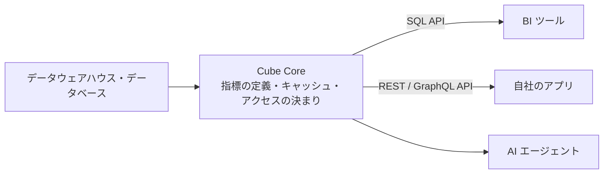

# Cube Core（指標の定義を1か所にまとめるセマンティックレイヤー）

> 非公式の解説です（Thoughtworks とは関係がありません）。Claude Code（AI）が作成しました。状態が「公開承認済み」の解説は人が公開を承認していますが、内容の正確さを人が個別に確かめてはいません。「下書き」の解説は承認前の作成中のものです。詳しくは [README](../../README.md) を参照してください。

| 項目 | 内容 |
|---|---|
| 版 | Technology Radar Vol.35（2026年11月） |
| 象限 | Tools（開発や運用に使う道具） |
| リング | Trial（新規か移動かは Radar のページに明記なし） |
| 状態 | 下書き |

## 1. 一言でいうと

Cube Core は、**「売上」「有効な利用者の数」のような分析の指標の定義を、コードとして1か所にまとめ、どの道具からも同じ定義で使えるようにする**オープンソースの道具です。こうした層を**セマンティックレイヤー**（意味の層）と呼びます。指標・分析の切り口（ディメンション）・表どうしのつなぎ方（結合）・アクセスの決まりをコードで一度定義し、SQL・REST・GraphQL の API を通じて、BI ツール（データを集計してグラフや表にする道具）や自社のアプリ、AI エージェントに提供します。画面は持たず（ヘッドレス）、ほかの道具の裏で働く部品です（[GitHub: cube-js/cube](https://github.com/cube-js/cube)）。

たとえるなら、会社の部署ごとにばらばらの電卓と計算式で「売上」を出していたのをやめ、全社で同じ計算の辞書を引くようにするようなものです（筆者の見立て）。

## 2. 解決する課題（なぜ生まれたか）

データの分析では、同じ「売上」でも、返品を引くか、税を含めるか、どの日付で区切るかで数字が変わります。その計算をダッシュボードごと、SQL の問い合わせごとに書いていると、定義が重複し、少しずつずれていきます。会議で部署ごとに違う数字が出てくる、という状態です（[Radar のページ](https://www.thoughtworks.com/en-us/radar/tools/cube-core)も、指標の重複とずれ〈metric drift〉を課題に挙げています）。

最近は、ここに AI が加わりました。AI エージェントに「先月の売上は？」と聞くと、エージェントが自分で SQL を書きます。このとき、正しい定義を知らなければ、もっともらしいが違う数字を返しかねません（筆者の見立て）。指標の定義を1か所にまとめ、人の道具にも AI にも同じ定義を渡すことが、ますます大事になっています（[Radar のページ](https://www.thoughtworks.com/en-us/radar/tools/cube-core)も、アプリや AI エージェントがデータを使う場面が増えていることを背景に挙げています）。

## 3. 仕組みの概要

**全体の形**（[GitHub: cube-js/cube](https://github.com/cube-js/cube)。この項の出典は同じ）

図の内容を言葉で書くと、次の流れです。

1. **データの置き場所**: Snowflake・Databricks・BigQuery のようなデータウェアハウス（分析用の大きなデータベース）、Presto や Amazon Athena のような問い合わせの仕組み、Postgres のようなアプリのデータベースにつなぎます
2. **定義の層**: Cube Core の中に、指標・ディメンション・結合・アクセスの決まりをコードで書きます。コードで定義するので、Git で版を管理してレビューする運用もとりやすくなります（筆者の見立て）
3. **提供**: 定義に基づいて、SQL・REST・GraphQL の API で結果を返します。利用者は、生の表の代わりに、定義済みの指標やディメンション（「売上」「月」など）を指定して問い合わせます（筆者の見立て）

**定義のイメージ**（筆者の整理。実際の書き方は Cube のドキュメントを参照してください）

| 種類 | 例 |
|---|---|
| 指標 | 「売上」＝注文の金額の合計（返品と税を除く）、「注文数」＝注文の件数 |
| ディメンション | 「注文した月」「地域」「商品の分類」 |
| 結合 | 注文の表と顧客の表を、顧客の ID でつなぐ |
| アクセスの決まり | 各地域の担当者には、自分の地域の数字だけを見せる |

このように定義しておけば、BI ツールで「地域別・月別の売上」を出すときも、AI エージェントが同じことを聞かれたときも、同じ計算の式が使われます。

**キャッシュ**: 結果を一時的に保存して使い回す仕組み（キャッシュ）を内蔵しており、README は、API への問い合わせに1秒未満で応え、多くの同時の問い合わせをさばけるとしています。

**オープンソースと商用の関係**: 商用の製品の Cube は、Cube Core の上に作られた分析の基盤で、チャットでの分析、ダッシュボード、運用の代行、役割ごとの権限の管理（RBAC）、複数の顧客を分けて扱う仕組み（マルチテナント）、Excel・Tableau などとの連携を足しています。データモデル（定義）は両者で互換とされています。ライセンスは、README によるとサーバー側の部品が Apache 2.0、クライアント側の部品が MIT です。

**開発用のモードの注意**: README は、開発用のモード（`CUBEJS_DEV_MODE=true`）ではREST と GraphQL の API でトークン（JWT）の検証が止まり、認証なしでアクセスできてしまうので、本番や公開のネットワークでは使わないよう警告しています。

## 4. アーキテクチャ上の位置づけとトレードオフ

**位置づけ**: データ基盤の中で、「保存の層（データウェアハウス）」と「利用の層（BI・アプリ・AI）」の間に入る層です。アプリの設計で、データベースを直接触らせずに API を挟むのと同じ考え方を、分析の指標に当てはめたものです（筆者の見立て）。

**得られるもの**

- **一貫した数字**: 定義が1か所なので、どの道具から見ても同じ数字になる（[Radar のページ](https://www.thoughtworks.com/en-us/radar/tools/cube-core)）
- **コードとしての管理**: [README](https://github.com/cube-js/cube) は定義をコードで書くとしている。Git で変更をレビューし、履歴を残せる（Git での管理は筆者の見立て）
- **AI への安全な入口**: AI に生の表を渡す代わりに、定義済みの指標を API で渡せる（[README](https://github.com/cube-js/cube) は AI エージェントを提供先に挙げている。安全になるという評価は筆者の見立て）
- **速さ**: キャッシュで、同じ集計の問い合わせを速く返せる（[README](https://github.com/cube-js/cube)）

**代わりに失うもの・注意点**

- **もう1つの層**: Cube Core 自体を動かし、監視し、更新する手間が増える（筆者の見立て）
- **定義の保守**: 定義をまとめるだけでは足りず、誰が定義を決め、変更をどう承認するかという運用が要る（筆者の見立て）
- **キャッシュの鮮度**: 結果を使い回すぶん、データの更新との時間差が出うる。どの指標をどれだけ新しく保つかを決める（筆者の見立て）
- **設定の誤り**: 開発用のモードを本番で使うと、認証なしで API が開いてしまう（README の警告）
- **定義への依存**: 多くの道具が Cube Core の定義に頼るようになるので、止まったときの影響が大きい。可用性（止まらずに動き続けること）の設計が要る（筆者の見立て）

## 5. 採用を判断するときの観点

- **困りごとの大きさ**: 部署や道具によって数字が違う、という問題が実際に起きているか。Thoughtworks は、データの定義の不一致に悩むチームに評価を勧めている（[Radar のページ](https://www.thoughtworks.com/en-us/radar/tools/cube-core)）
- **利用者の数**: 指標を使う道具やチームが多いほど、まとめる価値が大きい（筆者の見立て）
- **既存の道具との重なり**: 使っている BI ツールやデータの変換の道具（dbt など）が、すでに似た定義の仕組みを持っていないか（筆者の見立て）
- **自前か商用か**: 自分たちで動かすなら Cube Core、運用を任せたり画面が欲しかったりするなら商用の製品、という分け方ができる（README の関係に基づく筆者の見立て）
- **データの置き場所**: 使っているデータウェアハウスやデータベースに対応しているか（README）
- **段階的な移行**: 最初はよく使われる数個の指標だけを Cube Core に移し、ダッシュボードの数字が今までと一致するかを確かめながら広げる（筆者の見立て）
- **AI に渡す前の確認**: AI エージェントに使わせる前に、どの指標を見せてよいか、アクセスの決まりが効いているかを確かめる（筆者の見立て）

## 6. 関連技術・代替技術

- **Semantic layer**: [Radar の Cube Core のページ](https://www.thoughtworks.com/en-us/radar/tools/cube-core)の関連の項目に挙がっています（手法としてのセマンティックレイヤー）
- **Open Data Contract Standard (ODCS)**: データの形や品質の約束を書く標準。セマンティックレイヤーが「指標の意味」を決めるのに対し、データの受け渡しの約束を決めるもので、補い合う（[解説](../languages-and-frameworks/open-data-contract-standard-odcs.md)。筆者の見立て）
- **代替: BI ツールの中の定義**: 1つの BI ツールだけを使うなら、そのツールの中で指標を定義する仕組みで足りることがある（筆者の見立て）

## 7. Radar での扱い

- Vol.35（2026年11月）: **Trial**（新規か移動かは Radar のページに明記なし）
- 過去の版: Radar のページの推移には、今回の版だけが載っています
- Thoughtworks の評価の要旨: データの定義の不一致に悩むチームに評価を勧めています。根拠として、最近のプロジェクトでセマンティックレイヤーの実装に使えたことと、開発とコミュニティが活発なことを挙げています
- Radar のページ: https://www.thoughtworks.com/en-us/radar/tools/cube-core

## 8. 深掘りするときの一次情報

- [GitHub: cube-js/cube](https://github.com/cube-js/cube)
- [Cube の公式サイト](https://cube.dev/)

## 9. 確認日

- 内容の確認日: 2026-11-13
- Radar の評価の確認日: 2026-11-13

## 用語集

| 用語 | 説明 |
|---|---|
| セマンティックレイヤー | 指標や切り口の意味と計算方法をまとめて定義し、どの道具からも同じ定義で使えるようにする層 |
| 指標（メジャー） | 売上や件数のように、集計して求める数値 |
| ディメンション | 地域・月・商品など、指標を分けて見るための切り口 |
| 結合（join） | 複数の表を、共通の項目でつないで1つにすること |
| BI ツール | データを集計して、グラフや表、ダッシュボードにする道具 |
| データウェアハウス | 分析のために、多くのデータを集めて保存する大きなデータベース |
| SQL | データベースの表を読み書きするための言語 |
| API | プログラムどうしがやりとりするための決まった窓口 |
| REST / GraphQL | Web で API を提供するときの代表的な方式 |
| キャッシュ | 一度出した結果を一時的に保存して、次に速く返す仕組み |
| ダッシュボード | 主な指標をグラフなどでまとめて表示する画面 |
| 認証 | 利用者が誰かを確かめる仕組み |
| ヘッドレス | 自分では画面を持たず、API を通じてほかの道具に機能を提供する作り |
| 可用性 | システムが止まらずに使い続けられること。止まったときの影響を小さくする設計も含む |
